# 嘉善技师学院 AI 智聘平台三角色功能流程手册

核验日期：2026 年 10 月 21 日。站点：http://211.154.20.65:20018。

本文件为可维护文字源；完整排版与核验范围见同目录 Word 手册。

## G01 登录与识别工作台

身份：通用。入口：网站首页 → 登录。核验：三种身份均已实际登录。

1. 打开 http://211.154.20.65:20018，输入账号及对应密码，点击“登录并继续”。
2. 学生账号进入面试大厅；管理员进入教学工作空间；企业账号进入企业招聘工作台。
3. 核对右上角姓名及顶部菜单，再开始操作；切换账号前先退出当前登录。

本次三个账号均登录成功。密码不写入手册；账号或密码错误时，页面会显示错误提示。

## S01 面试大厅与练习概况

身份：学生。入口：学生工作台 → 面试大厅。核验：页面已核验。

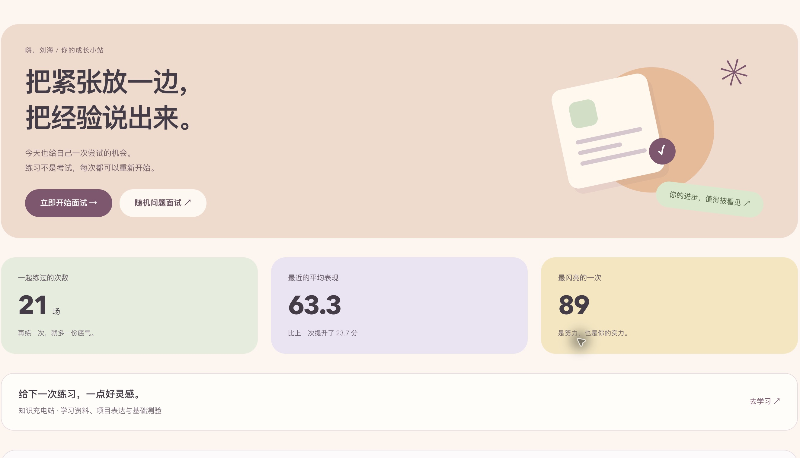

1. 查看累计练习次数、最近平均表现及历史最佳，了解自己的练习情况。
2. 点击“立即开始面试”配置岗位练习，或点击“随机问题面试”进入单题快练。
3. 向下滚动查看近期面试记录，点击“查看报告”；记录较多时使用底部分页。

示例账号为刘海 222308。首页显示的次数与分数是采集时的历史数据，会随练习变化。

## S02 配置公司岗位与模拟面试

身份：学生。入口：面试大厅 → 立即开始面试。核验：配置已核验  未启动新面试。

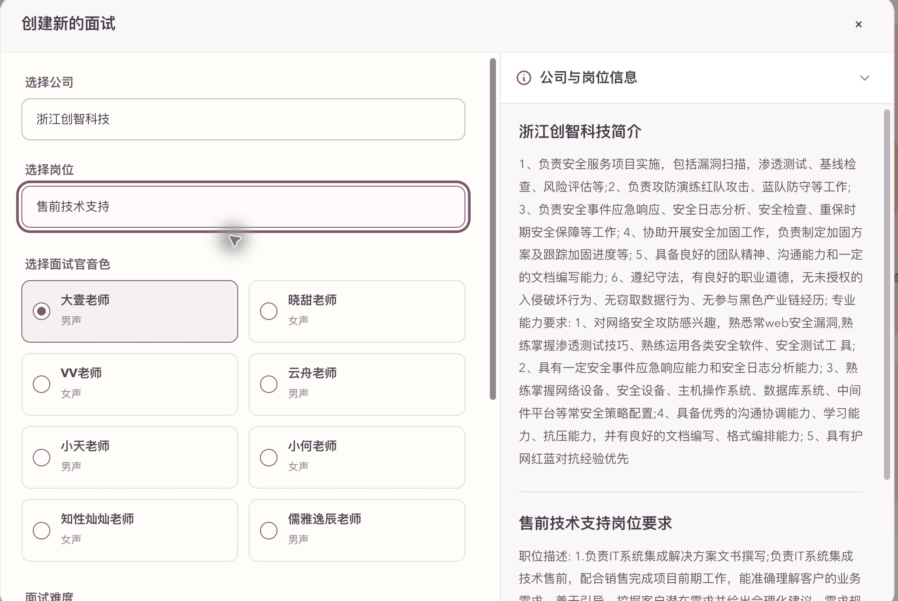

1. 先选择公司，再选择岗位；右侧查看公司介绍和岗位要求。示例选择浙江创智科技的售前技术支持。
2. 在左侧配置区选择面试官音色，再向下滚动选择新手、标准或压力模式，以及本次递交的简历或盲面。
3. 确认后点击“开始模拟面试”。后续按题作答；完成后查看报告，再按提示开展下一次练习。

页面提示：所属公司可查看该岗位的面试记录及本次递交简历。本次只核验配置表单，未新建面试；实时作答界面未实测。

## S03 随机问题单题快练

身份：学生。入口：面试大厅 → 随机问题面试。核验：页面及输入入口已核验  分析未提交。

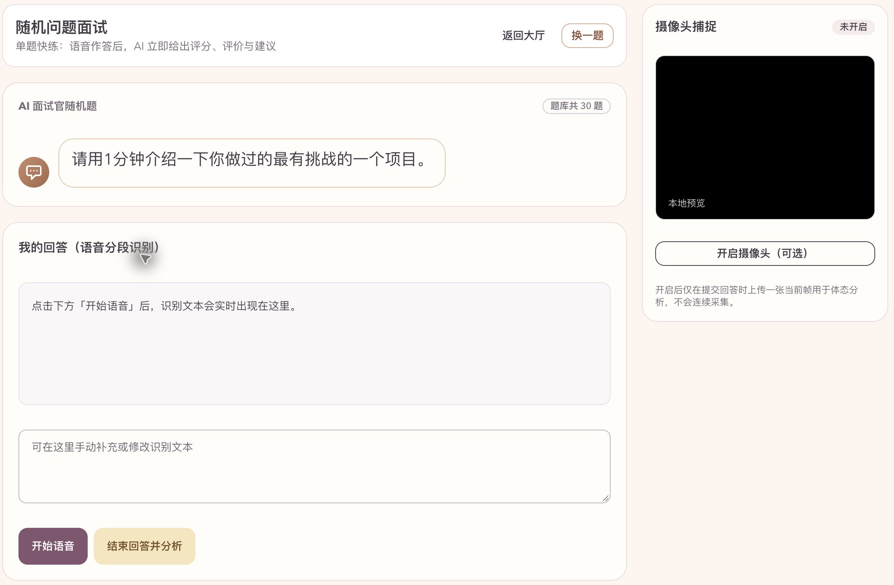

1. 阅读随机抽取的问题，点击“换一题”切换题目；采集时题库共 30 题。
2. 使用“开始语音”作答，或直接在下方文本框输入、补充或修改答案。
3. 点击“结束回答并分析”请求评分、评价与建议；摄像头为可选项，开启后提交回答时采集当前帧。

当前地址为 HTTP，页面提示音视频需要安全连接。建议由管理员提供有效 HTTPS 地址；本次未开启设备或提交答案。

## S04 浏览学习资料与进度

身份：学生。入口：顶部导航 → 学习资料。核验：页面已核验。

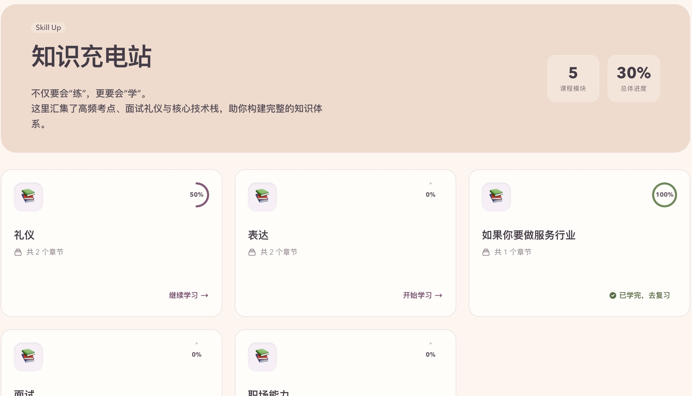

1. 进入知识充电站，查看课程模块数和总体进度。
2. 选择礼仪、表达、如果你要做服务行业、面试或职场能力课程卡片。
3. 按卡片上的“开始学习”“继续学习”或“已学完，去复习”进入课程。

采集时显示 5 个课程模块、总体进度 30%。完成状态按当前账号分别记录。

## S05 阅读课程与切换章节

身份：学生。入口：学习资料 → 课程卡片 → 文章章节。核验：页面已核验。

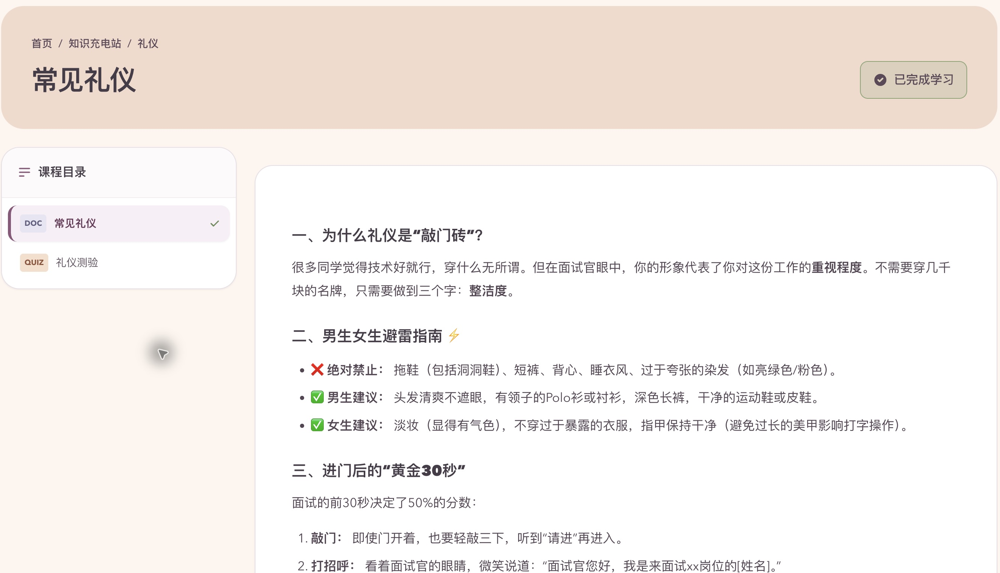

1. 左侧查看课程目录，点击 DOC 章节阅读正文，点击 QUIZ 章节进入测验。
2. 阅读正文并查看页面的学习状态；本次示例“常见礼仪”显示已完成学习。
3. 使用页底“上一节”“下一节”连续学习，或通过顶部面包屑返回知识充电站。

课程文章与测验位于同一目录中。本次阅读的是已有完成记录，没有代替学生提交测验。

## S06 完成随堂测验

身份：学生。入口：课程目录 → QUIZ 测验章节。核验：题目与提交入口已核验  未交卷。

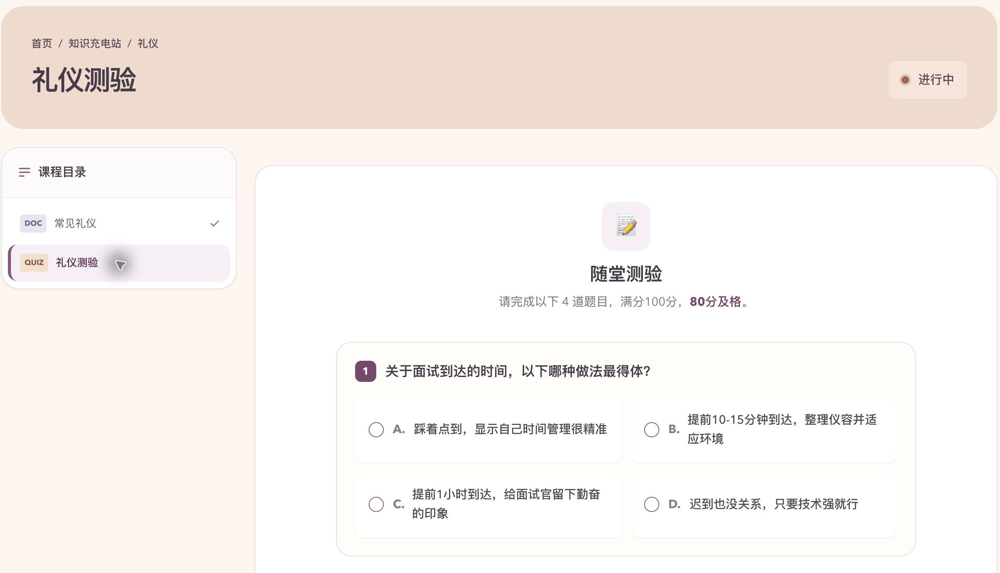

1. 查看题目数量和及格要求。示例礼仪测验共 4 题，满分 100 分，80 分及格。
2. 逐题选择答案，向下滚动完成其余题目。
3. 核对答案后点击页底“提交试卷”，根据页面反馈安排后续学习。

本次核验题目、单选项和提交入口，未代答或提交；提交后的成绩反馈与进度变化未实测。

## S07 查看五维能力与成长轨迹

身份：学生。入口：顶部导航 → 能力成长。核验：能力图与轨迹切换已核验  诊断未生成。

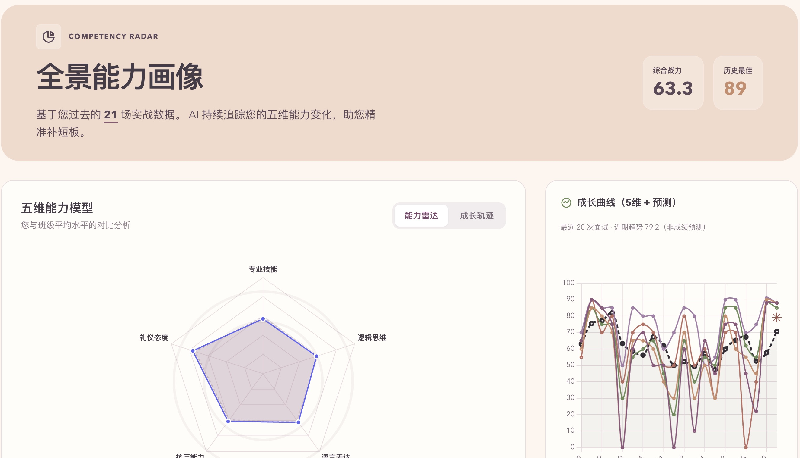

1. 查看综合战力、历史最佳及五维能力模型，对比个人与班级平均水平。
2. 点击“成长轨迹”切换近期得分走势；右侧查看五维成长曲线及趋势提示。
3. 向下滚动，可点击“生成诊断报告”请求 AI 职业诊断，并查看智能推荐训练入口。

五维包括专业技能、逻辑思维、语言表达、抗压能力和礼仪态度。趋势标注为非成绩预测；部分推荐训练链接当前指向本页锚点。

## S08 查找练习记录与打开报告

身份：学生。入口：顶部导航 → 练习记录。核验：页面已核验。

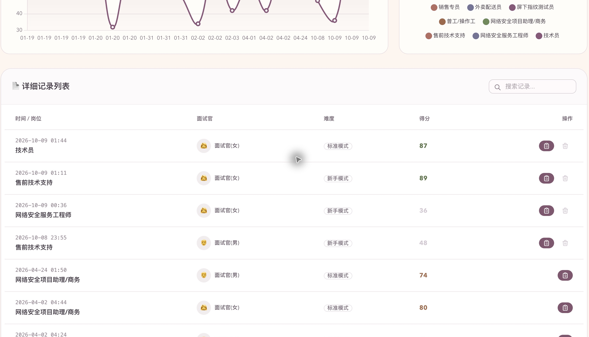

1. 查看累计模拟、平均分、最高分，以及成长曲线和练习岗位分布。
2. 下滚到详细记录列表，按时间、岗位、面试官、难度及得分识别记录。
3. 点击“查看报告”进入复盘；底部分页可浏览其他记录。部分近期记录提供“隐藏记录”入口。

采集时搜索框为禁用状态，不作为可用搜索功能介绍。本次未隐藏记录；隐藏操作的后续恢复流程未实测。

## S09 阅读面试总评与画面复盘

身份：学生。入口：面试大厅或练习记录 → 查看报告。核验：页面已核验。

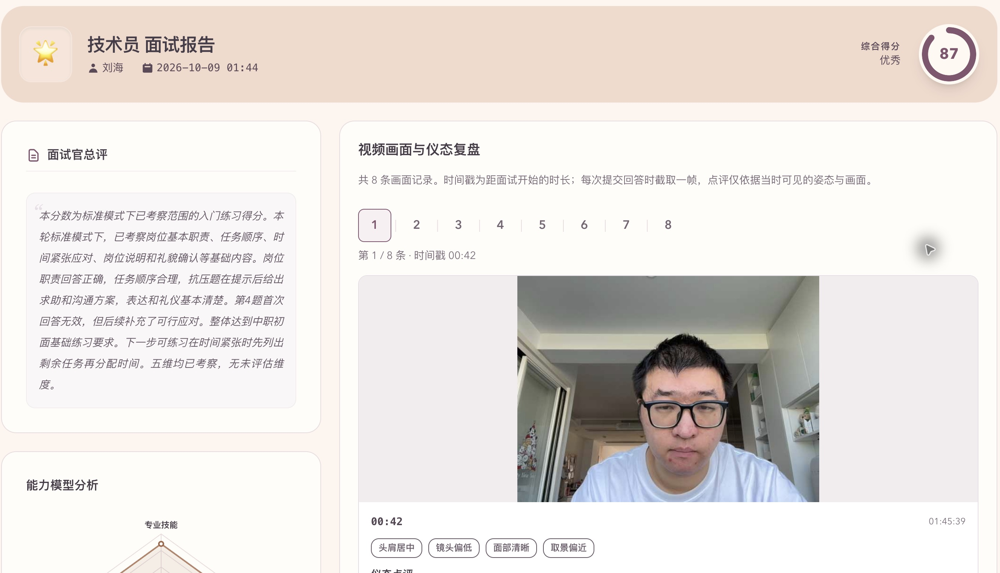

1. 先核对岗位、时间和综合得分，阅读面试官总评及五维能力分析。
2. 在“视频画面与仪态复盘”中点击不同时间戳，查看对应画面、关键词与仪态点评。
3. 点击“查看对应回答”定位答复；点击完整画面链接查看原图；需要继续练习时可使用报告中的下一轮入口。

示例为历史技术员面试报告。画面点评只依据该帧可见姿态；下一轮入口已发现，本次未启动新一轮。

## S10 逐句复盘与参考回答

身份：学生。入口：面试报告 → 向下滚动到对话深度复盘。核验：历史复盘已核验  新评估未生成。

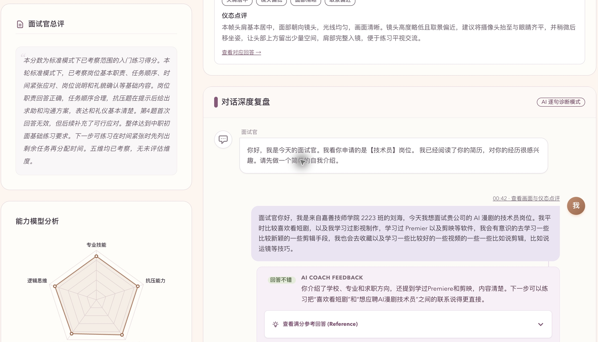

1. 按面试官问题与自己的回答逐条回顾，阅读每条回答下的 AI 评价或优化建议。
2. 展开“查看满分参考回答”对照表达方式；带画面时间戳的回答可跳回仪态复盘区域。
3. 报告下方提供“评估匹配度”，可请求岗位匹配分析，结合建议选择下一次训练重点。

本次核验已有问题、回答、逐句反馈及相关入口；未触发新的匹配度评估。参考回答展开后的内容未单独核验。

## S11 回看已结束面试对话

身份：学生。入口：面试报告 → 查看对话记录。核验：页面已核验。

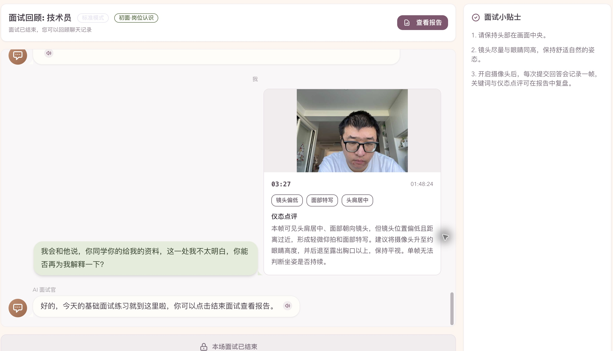

1. 进入面试回顾页，核对岗位、难度及当前面试状态。
2. 滚动对话区域查看面试官提问和学生回答；有画面记录时，可查看时间、关键词及仪态点评。
3. 点击“查看报告”返回评分页；右侧小贴士提供取景、视线和设备摆放建议。

本次截图为已结束面试，只提供回顾。不能将该页面当作正在作答的面试室截图。

## S12 管理个人简历库

身份：学生。入口：顶部导航 → 智能简历中心。核验：页面已核验。

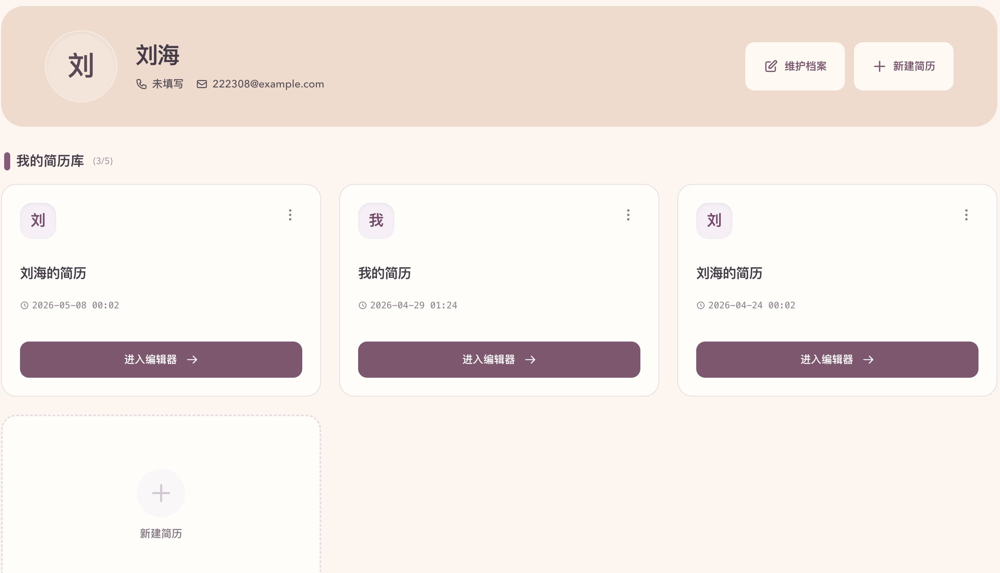

1. 查看简历卡片、名称与更新时间；点击“进入编辑器”打开某一份简历。
2. 点击“维护档案”维护新建简历时可导入的基础资料，或点击“新建简历”创建独立版本。
3. 页面存在重命名对话框；如需重命名，先通过简历卡片的管理入口进入，再核对名称后保存。

示例账号显示 3/5 份简历。重命名对话框已从页面控件核对，卡片管理入口未展开实测。

## S13 新建简历并导入基础档案

身份：学生。入口：智能简历中心 → 新建简历。核验：新建表单已核验  未创建。

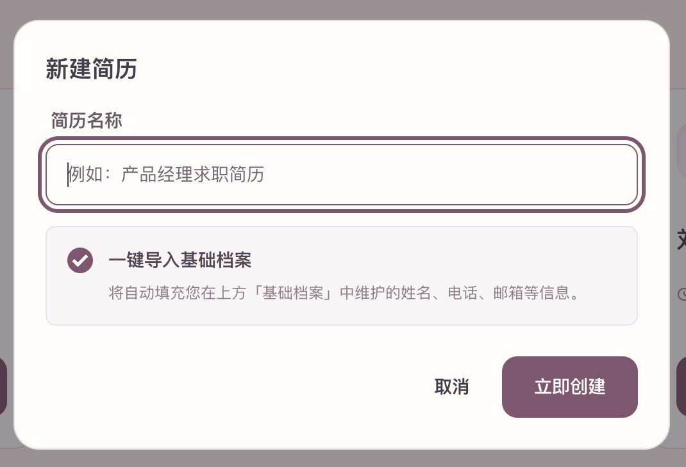

1. 在对话框填写便于区分的简历名称，例如对应岗位的求职简历。
2. 按需要保留或取消“一键导入基础档案”；勾选时导入姓名、电话、邮箱等母版信息。
3. 点击“立即创建”提交，或点击“取消”关闭；创建后再进入编辑器补齐经历。

本次只打开新建对话框，未创建简历。导入的是基础档案，不应假定包含其他简历中的全部经历。

## S14 编辑简历与导出 PDF

身份：学生。入口：智能简历中心 → 进入编辑器。核验：编辑器及导出入口已核验  未改写或导出。

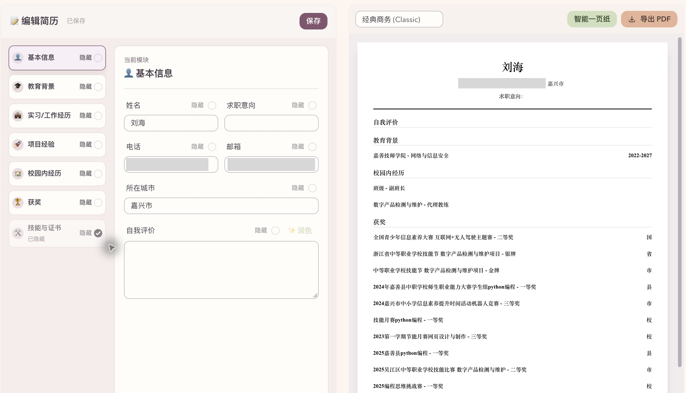

1. 在左侧切换基本信息、教育背景、实习工作经历、项目经验、校园经历、获奖和技能证书模块。
2. 在中间填写内容，按需隐藏模块或字段；自我评价提供“润色”入口；查看右侧实时预览并保存。
3. 选择简历模板，按需使用“智能一页纸”调整，再点击“导出 PDF”。

本次打开已有简历，未改写简历、调用润色或导出文件。截图中的真实手机号和邮箱已遮盖。

## S15 维护个人基础资料

身份：学生。入口：顶部导航 → 基本资料 或 智能简历中心 → 维护档案。核验：两处入口已核验  字段内容未更改。

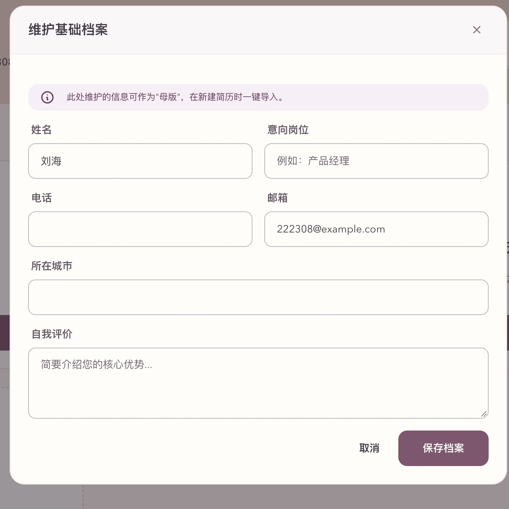

1. 填写姓名、求职意向、电话、邮箱、所在城市和自我评价。
2. 核对信息后，在基本资料页点击“保存信息”，或在维护基础档案弹窗点击“保存档案”。
3. 以后新建简历时勾选“一键导入基础档案”；已有简历是否同步更新，应另行核对。

基础档案作为新建简历的母版。本次未修改字段内容；取证过程中发生一次原值保存，不构成资料更新。

## S16 查看班级风云榜

身份：学生。入口：顶部导航 → 班级风云榜。核验：页面已核验。

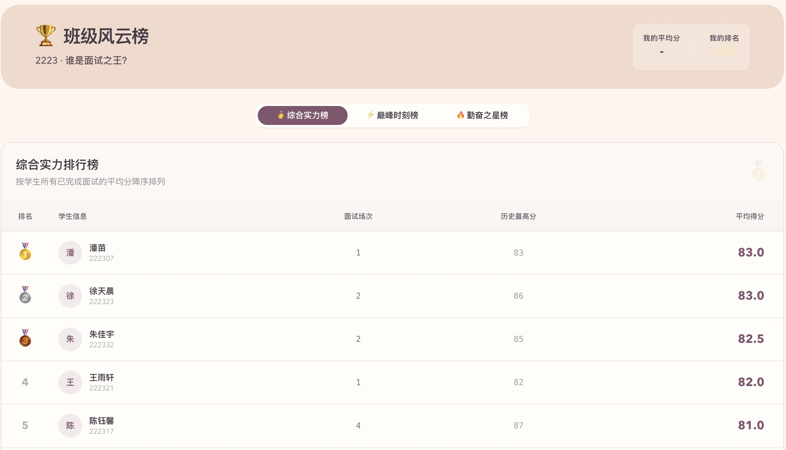

1. 先核对当前班级及自己的排名信息。
2. 切换“综合实力榜”“巅峰时刻榜”“勤奋之星榜”，分别查看不同维度的排行。
3. 结合列表中的面试场次、历史最高分和平均分了解练习情况。

采集时“我的平均分”显示横线，不能据此写成 0 分。综合榜已打开，另外两种榜单的切换结果未单独截图。

## A01 教学概览与最新面试

身份：管理员。入口：管理员登录 → 教学概览。核验：页面已核验。

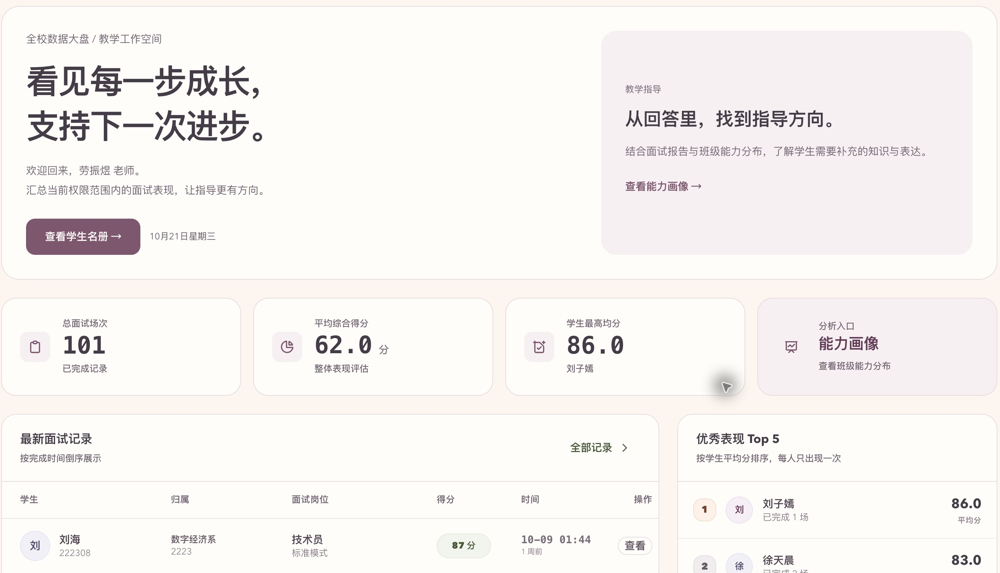

1. 查看当前权限范围内已完成面试场次、平均综合得分及学生最高均分。
2. 在最新面试记录中核对学生、班级、岗位、得分和时间，点击“查看”打开报告。
3. 使用学生名册、面试流水、能力画像快捷入口；展开“教学管理”进入其余管理功能。

采集时显示 101 场已完成面试、平均 62.0 分。统计是当前快照；优秀表现 Top 5 按学生平均分排序。

## A02 筛选学生名册与账号维护

身份：管理员。入口：顶部导航 → 学生名册。核验：页面已核验。

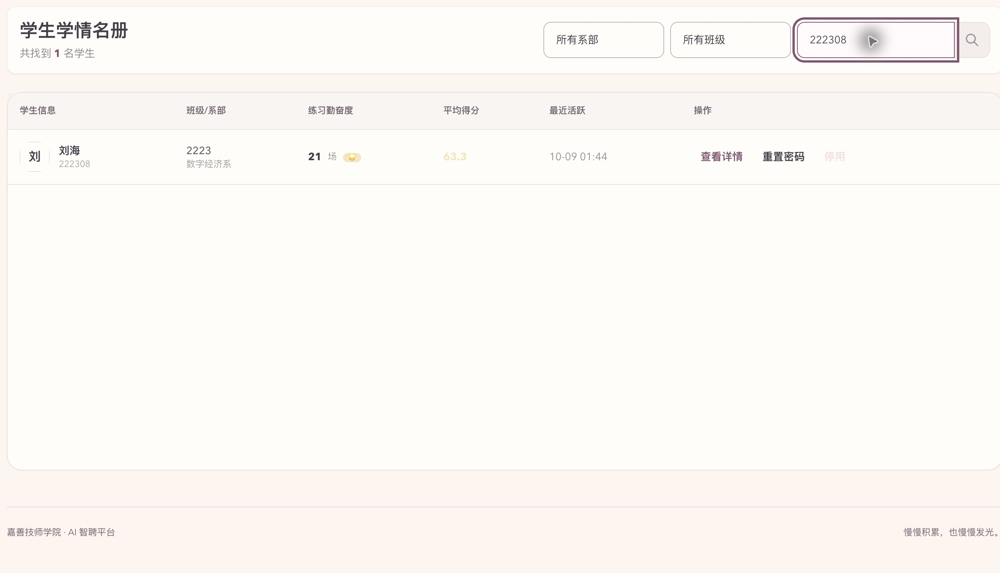

1. 使用系部、班级下拉框筛选，或输入姓名、学号搜索；示例搜索 222308。
2. 查看学生所属班级、练习次数、平均得分及最近活跃时间。
3. 点击“查看详情”进入学生档案；“重置密码”“停用”用于账号维护，操作前核对目标学生。

本次实际完成学号筛选并打开详情，没有重置密码或停用账号。此页不替代批量导入学生入口。

## A03 查看学生个体学情

身份：管理员。入口：学生名册 → 查看详情。核验：页面已核验。

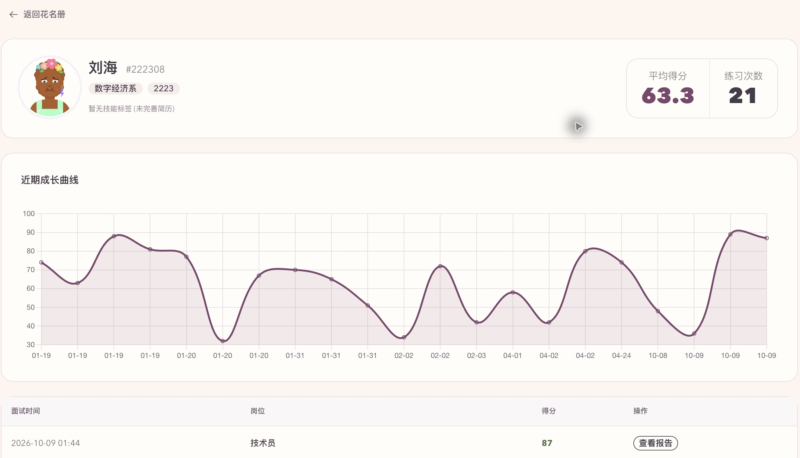

1. 核对姓名、学号、系部、班级及技能标签，查看平均分和练习次数。
2. 阅读近期成长曲线，向下查看历史面试时间、岗位和得分。
3. 选择某条“查看报告”，依据问题与回答开展具体指导；完成后返回花名册。

本次使用 222308 的历史记录核验。页面显示“暂无技能标签”不等于学生没有技能，仅表示此处未完善。

## A04 管理面试记录流水

身份：管理员。入口：顶部导航 → 面试记录。核验：页面已核验。

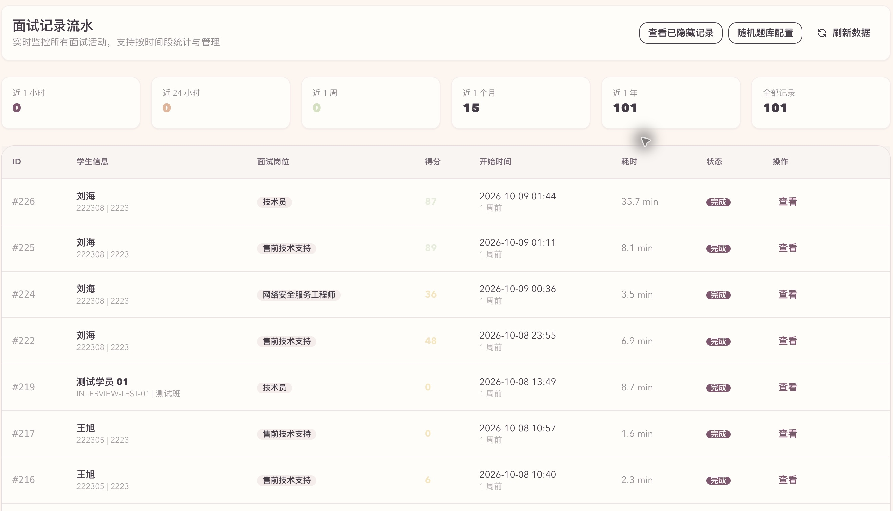

1. 查看近 1 小时、24 小时、1 周、1 个月、1 年及全部记录的统计，点击“刷新数据”更新。
2. 按学生、岗位、得分、开始时间、耗时和状态识别记录，点击“查看”进入面试报告。
3. 使用分页浏览；需要排查隐藏记录时点击“查看已隐藏记录”。记录行提供“隐藏”入口。

本次只查看记录，没有隐藏或恢复数据。页面提供的是时间窗口统计，不能默认其支持自定义起止日期筛选。

## A05 分析群体能力与偏差预警

身份：管理员。入口：顶部导航 → 能力画像。核验：页面已核验。

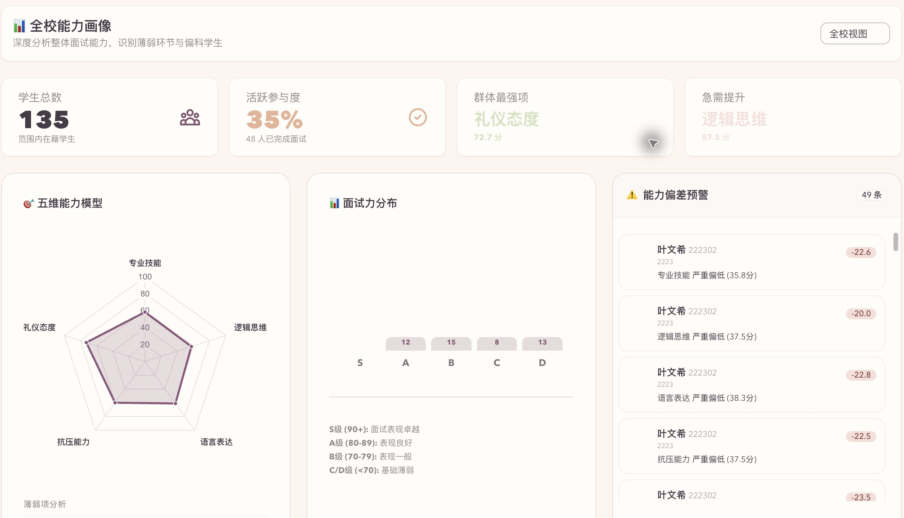

1. 用顶部视图选择器确定统计范围，查看学生总数及活跃参与度。
2. 结合五维能力模型、薄弱项分析和面试力分布，了解群体表现。
3. 查看能力偏差预警，定位需要进一步了解的维度，再回到学生档案核对具体回答。

示例全校视图显示 135 名学生、48 人已完成面试。预警是页面统计结果，本手册未据此作出学生考核或录用决定。

## A06 比较班级表现

身份：管理员。入口：教学管理 → 班级对比看板。核验：页面已核验。

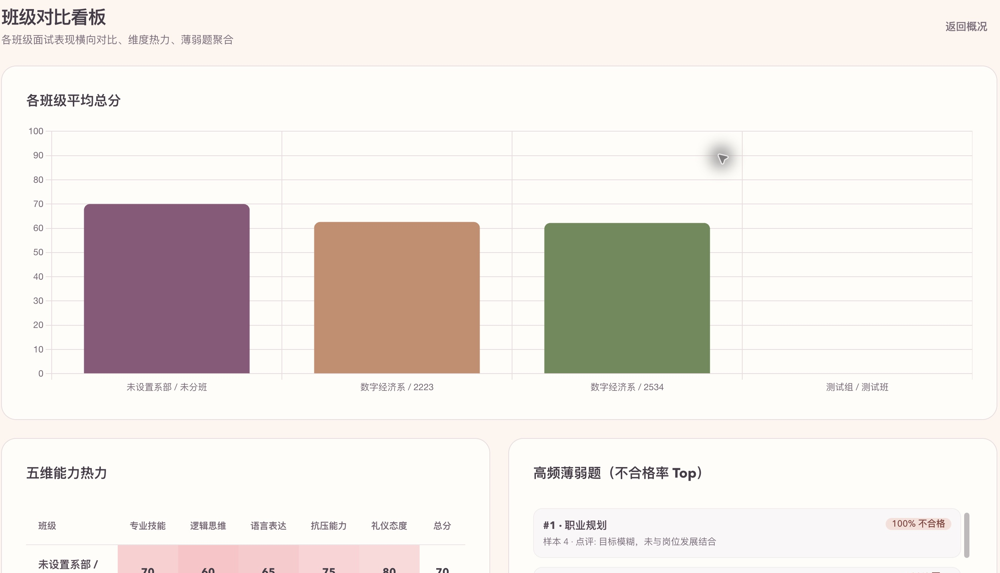

1. 查看各班级平均总分柱状图，识别参与统计的班级。
2. 下滚查看五维能力热力表，对比各班专业技能、逻辑、表达、抗压、礼仪及总分。
3. 查看“高频薄弱题”聚合区域，将结果作为后续课堂训练选题的参考。

页面包含未分班或测试班数据，阅读时应注意统计范围。该看板用于班级横向比较。

## A07 检索学生简历

身份：管理员。入口：教学管理 → 学生简历预览。核验：页面已核验。

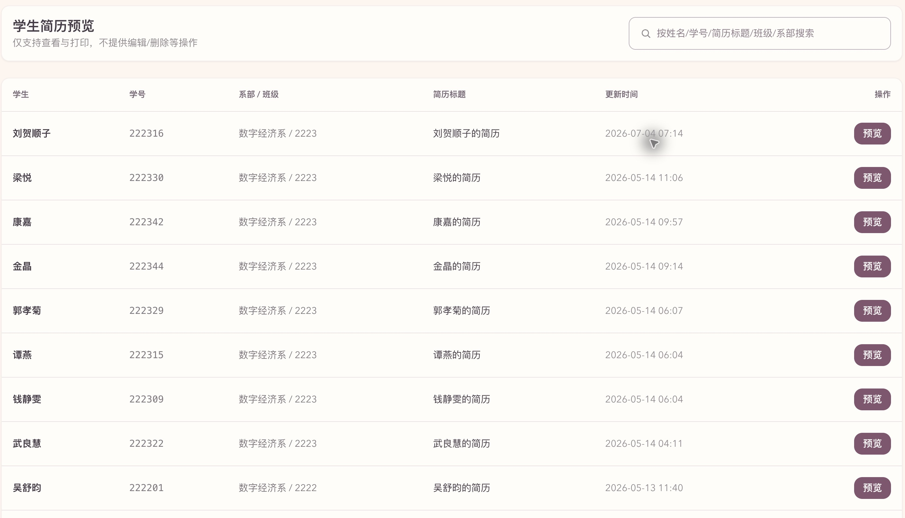

1. 在搜索框输入姓名、学号、简历标题、班级或系部信息。
2. 核对列表中的学生身份、系部班级、简历标题和更新时间。
3. 点击对应行“预览”，进入只读简历页面。

页面明确标注仅支持查看与打印，不提供编辑、删除等操作。搜索入口已核验，本次未另行验证多条件组合查询。

## A08 预览与打印学生简历

身份：管理员。入口：学生简历预览 → 对应简历 → 预览。核验：只读预览已核验  未打印。

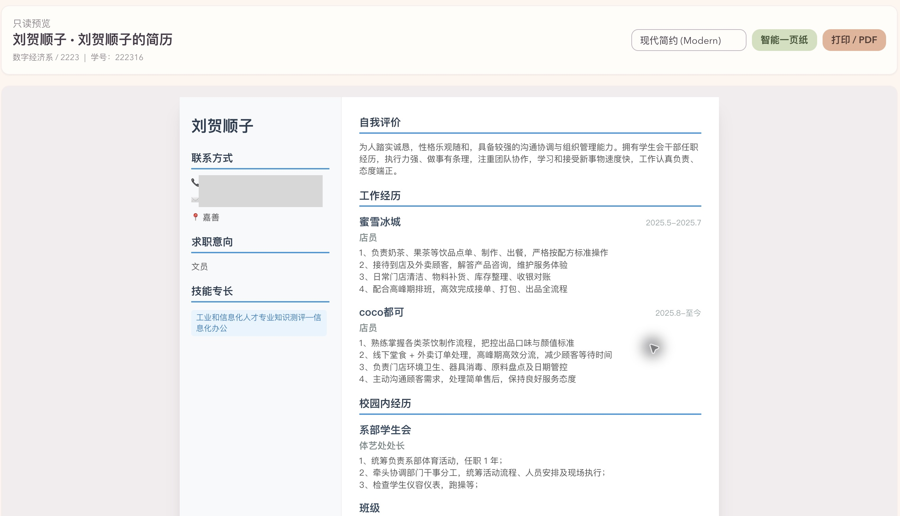

1. 核对只读预览标题中的学生身份及学号，阅读简历内容。
2. 选择显示模板，按需要使用“智能一页纸”调整预览。
3. 点击“打印 / PDF”打开打印流程，完成纸质打印或另存 PDF。

本次核验只读页面和打印入口，没有改写学生简历或实际打印。截图中的联系方式已遮盖。

## A09 管理课程分类与内容清单

身份：管理员。入口：教学管理 → 课程内容管理。核验：页面已核验。

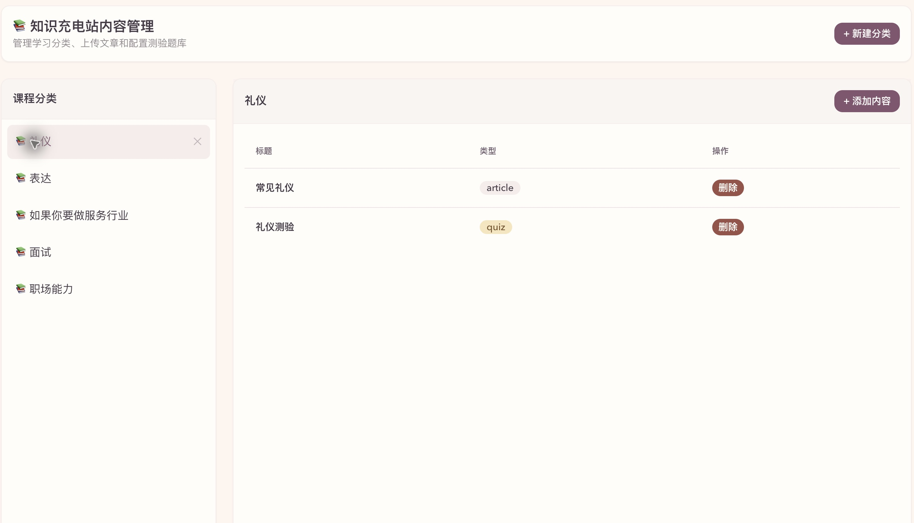

1. 点击“新建分类”建立学习分类；管理现有内容时先点击左侧分类名称。
2. 右侧查看该分类下的文章和测验，以及对应的内容类型。
3. 点击“添加内容”进入表单；分类旁的叉号和内容行的“删除”为移除入口，操作时核对目标。

本次打开礼仪分类，确认包含文章与测验。未新增分类或删除内容；删除后的恢复机制未实测。

## A10 新增学习文章或测验

身份：管理员。入口：课程内容管理 → 分类 → 添加内容。核验：新增表单已核验  未保存。

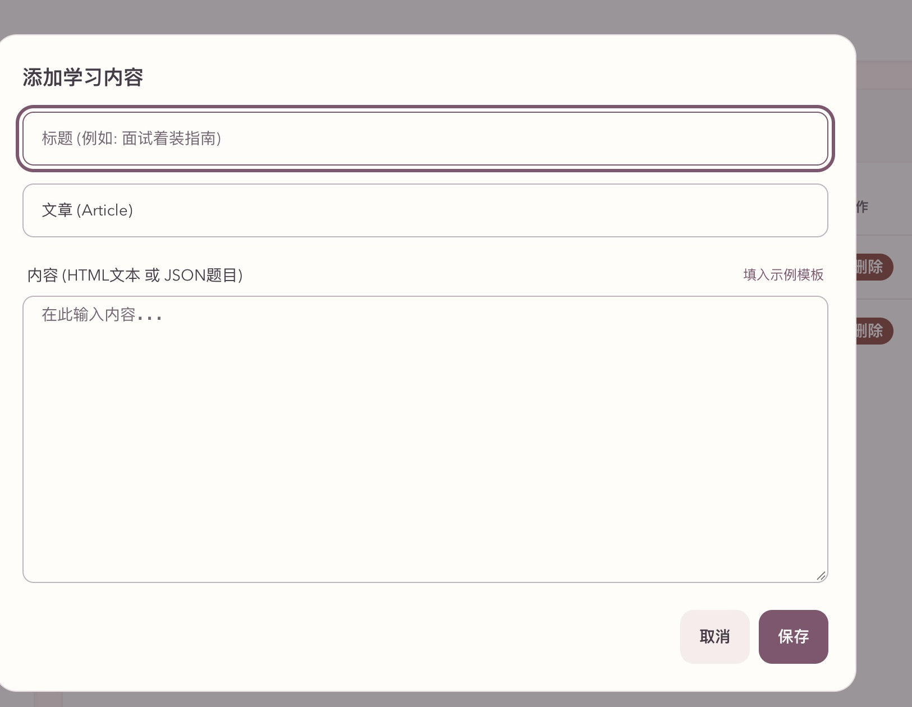

1. 输入内容标题，在类型下拉框中选择文章或测验。
2. 根据类型填写内容；页面标注支持 HTML 文本或 JSON 题目，并提供“填入示例模板”。
3. 核对分类、标题、类型及内容后保存；不发布时取消。

新增表单已打开，未提交。建议先利用示例模板理解格式；具体 JSON 字段应以页面模板为准。

## A11 维护系部与班级

身份：管理员。入口：教学管理 → 组织与学生管理。核验：页面已核验。

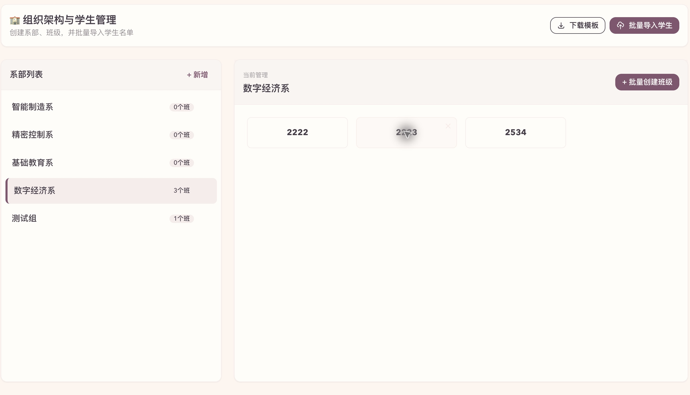

1. 左侧系部列表点击“新增”建立系部，或选择已有系部进行管理。
2. 右侧核对当前系部，点击“批量创建班级”进入班级创建流程。
3. 查看该系部班级卡片；移除系部或班级前核对目标及其现有学生归属。

本次选择数字经济系，看到 2222、2223、2534 三个班级。未新增、删除或调整学生归属。

## A12 批量导入学生名单

身份：管理员。入口：组织与学生管理 → 下载模板 → 批量导入学生。核验：导入表单已核验  未上传。

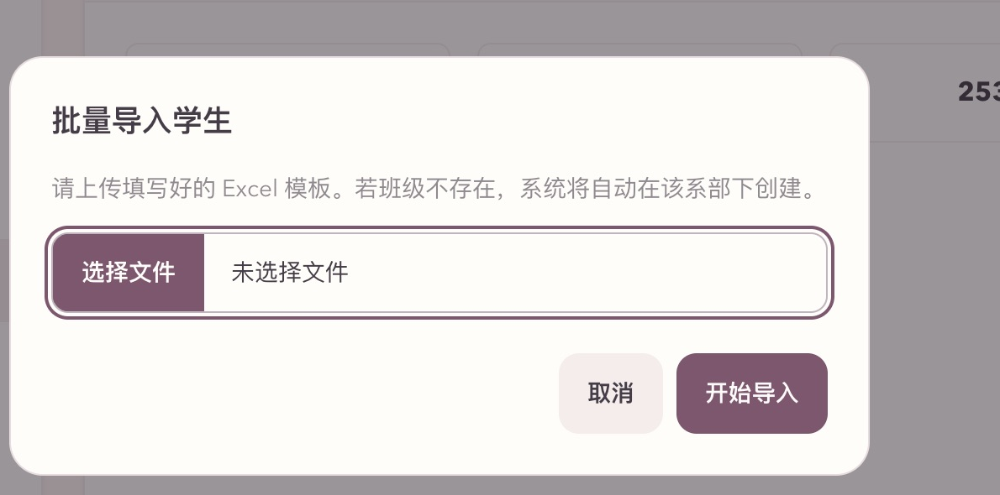

1. 先下载系统提供的 Excel 模板，按模板要求填写学生名单。
2. 点击“批量导入学生”，选择填写完成的模板文件，核对拟导入范围。
3. 点击“开始导入”，再回到学生名册核对结果；取消则关闭导入窗口。

页面提示：班级不存在时，系统会在对应系部下自动创建。本次只查看导入窗口，没有上传或导入名单。

## A13 开通校企合作账号

身份：管理员。入口：教学管理 → 校企合作管理。核验：开通表单已核验  未开通。

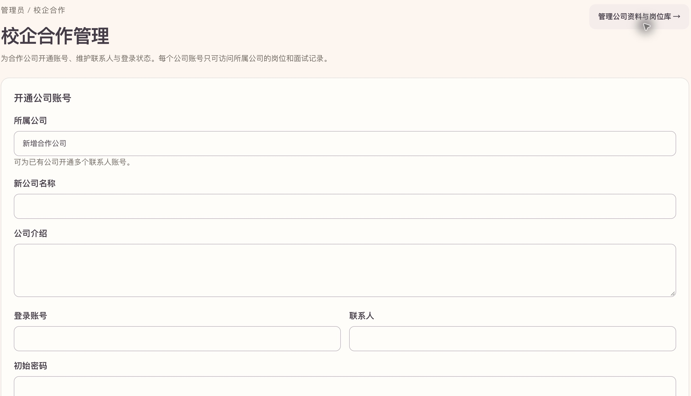

1. 选择已有公司，或保留“新增合作公司”并填写新公司名称及介绍。
2. 填写登录账号、联系人和初始密码；页面要求初始密码至少 10 个字符，首次登录需修改。
3. 核对所属公司后点击“开通公司账号”；已有公司可以开通多个联系人账号。

本次只核验表单，未新建公司账号。页面提示每个企业账号只可访问所属公司的岗位和面试记录。

## A14 维护企业联系人与登录状态

身份：管理员。入口：校企合作管理 → 下滚到公司账号。核验：维护入口已核验  未变更。

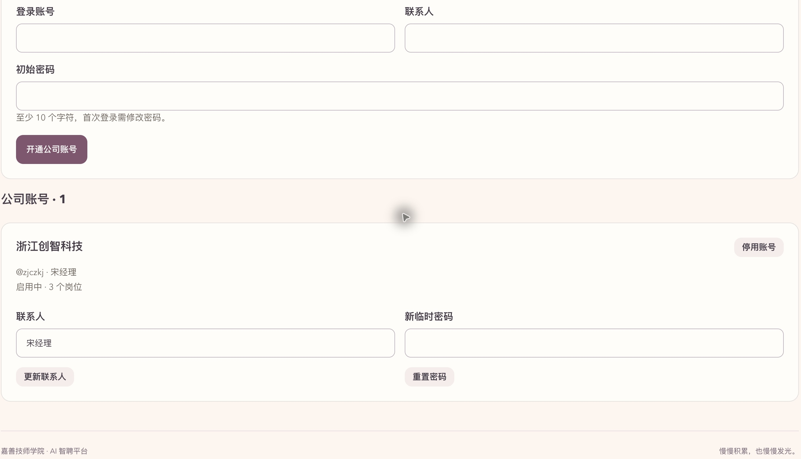

1. 核对公司名称、登录账号、联系人、启用状态和岗位数量。
2. 更新联系人时修改对应输入框并点击“更新联系人”。
3. 需要停用时使用“停用账号”；需要密码重置时，由管理员核对账号并自行完成临时密码设置。

示例为浙江创智科技 zjczkj、联系人宋经理。本次未更新联系人、停用账号或重置密码。

## A15 管理企业资料与岗位库

身份：管理员。入口：教学管理 → 企业与岗位管理。核验：页面已核验。

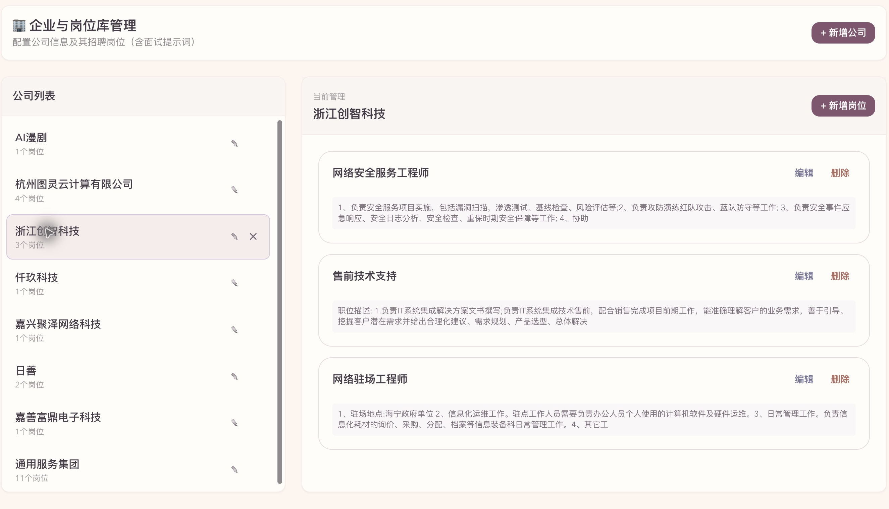

1. 在左侧公司列表选择目标公司，右侧查看该公司的岗位。
2. 点击“新增公司”维护新企业；公司旁的编辑符号进入公司资料修改，叉号为删除入口。
3. 在岗位卡片中点击“编辑”维护岗位，或点击“新增岗位”建立岗位；删除前核对目标岗位。

本次选择浙江创智科技，核验其 3 个岗位及编辑、删除入口，没有修改或删除企业与岗位。

## A16 新增岗位与维护面试要求

身份：管理员。入口：企业与岗位管理 → 公司 → 新增岗位。核验：岗位表单已核验  未保存。

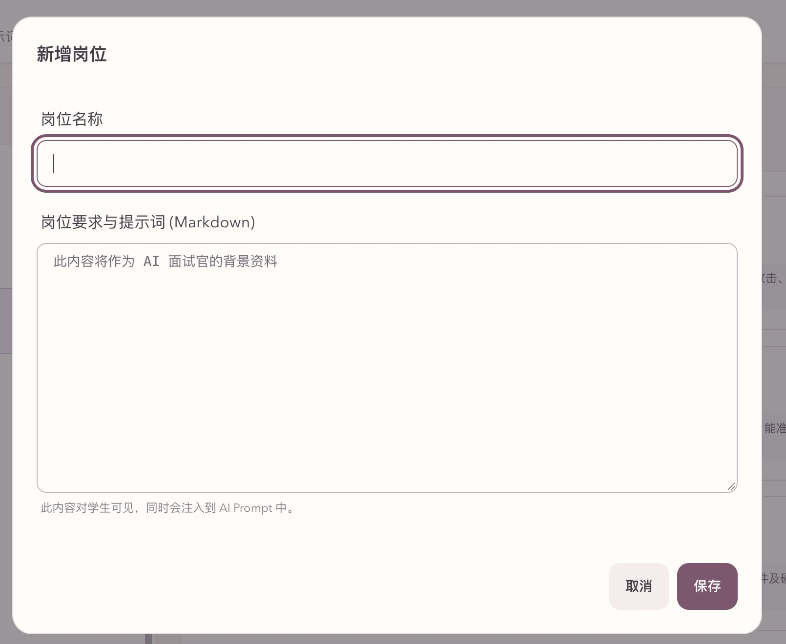

1. 确认当前管理公司，填写岗位名称。
2. 在“岗位要求与提示词”中填写职责、技能与考察要求；输入区支持 Markdown。
3. 核对内容后保存，或取消关闭。已有岗位可通过“编辑”进入类似维护流程。

页面明确说明内容对学生可见，同时作为 AI 面试的背景资料。本次只打开新增表单，未发布岗位。

## A17 配置随机面试问题题库

身份：管理员。入口：教学管理 → 随机问题题库。核验：页面已核验。

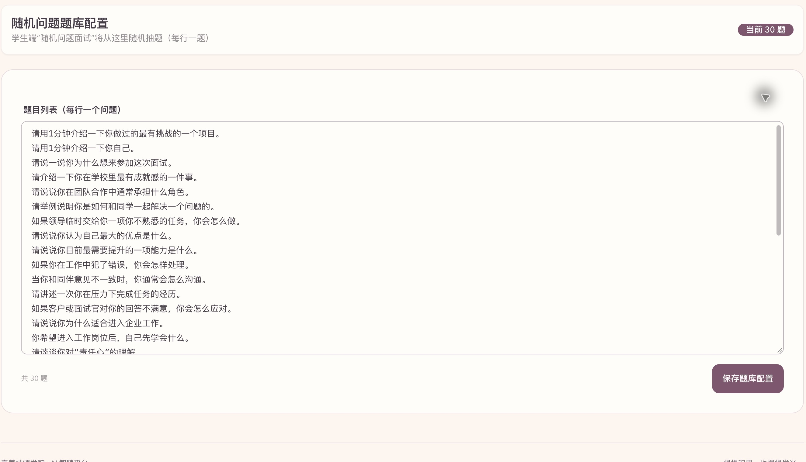

1. 查看当前题数和文本框中的题目列表。
2. 每行输入一个独立问题，修改时保留清晰的题目边界。
3. 确认后点击“保存题库配置”；学生端随机问题面试会从该列表抽题。

采集时题库为 30 题。本次没有修改题目或保存题库。

## A18 配置语音视频功能开关

身份：管理员。入口：教学管理 → 系统设置 → AI 面试官配置。核验：页面已核验。

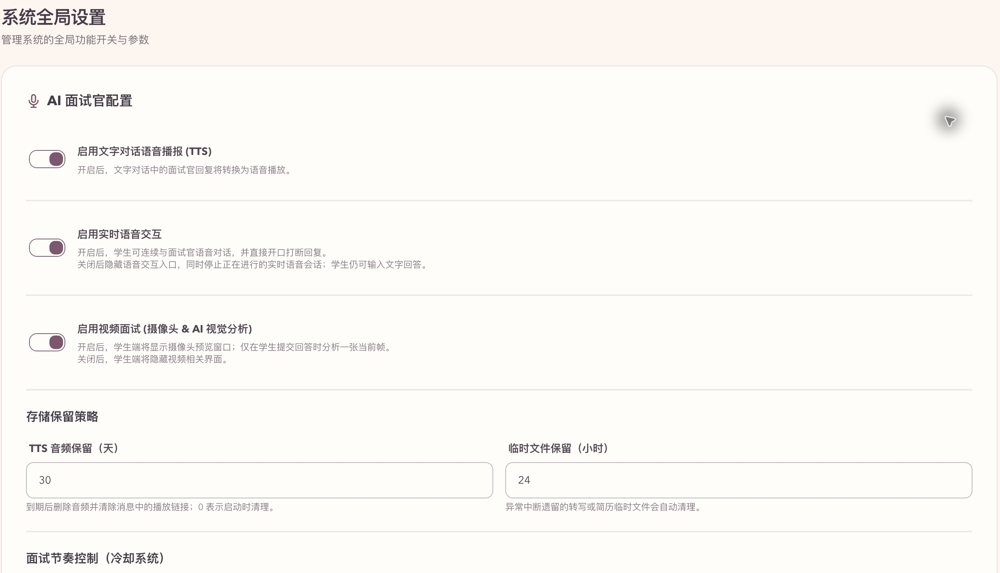

1. 按教学安排查看文字对话语音播报 TTS、实时语音交互和视频面试三个开关。
2. 阅读开关说明：实时语音支持连续对话与打断；视频分析在提交回答时使用一张当前帧。
3. 需要变更时统一调整并点击“保存设置”，再使用学生账号核对入口变化。

采集时三个开关均启用。页面提示关闭实时语音会停止正在进行的会话；本次没有保存配置变更。

## A19 配置存储保留与练习冷却

身份：管理员。入口：系统设置 → 下滚到存储保留策略与面试节奏控制。核验：页面已核验。

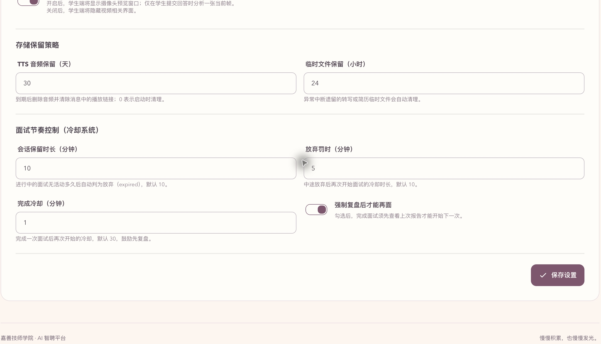

1. 设置 TTS 音频保留天数和临时文件保留小时数，核对清理说明。
2. 设置会话保留、放弃罚时、完成冷却的分钟数；按需要启用强制查看报告后才能再次面试。
3. 核对后保存。本次读取到的参数为 30 天、24 小时、10 分钟、5 分钟、1 分钟，强制复盘已勾选。

以输入框当前值为准：页面部分帮助文字中的默认值与当前值不同。本次未保存任何设置变更。

## A20 查看测试账号使用状态

身份：管理员。入口：右上角个人菜单 → 测试账号与使用状态。核验：页面已核验。

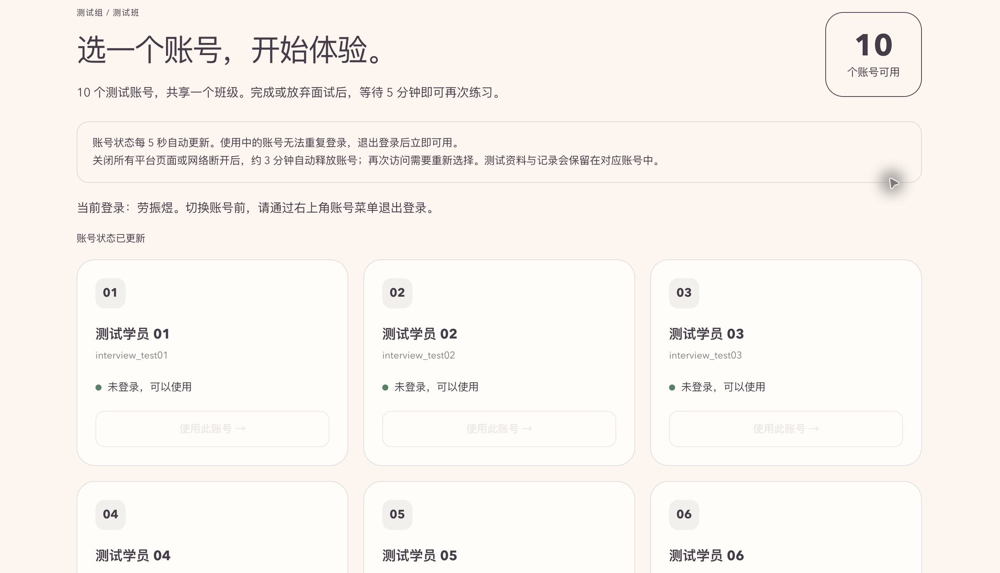

1. 进入测试账号页面，查看每个测试学员的可用或使用中状态。
2. 阅读页面说明，确认账号占用和释放规则；采集时页面显示 10 个测试账号。
3. 仅在测试入口允许且账号可用时选择使用；管理员已登录时截图中的“使用此账号”按钮为禁用状态。

页面说明状态每 5 秒更新，关闭页面或断网后约 3 分钟释放。这里用于查看状态，本次未切换测试账号。

## E01 查看公司招聘概览

身份：企业。入口：企业账号登录 → 公司概览。核验：页面已核验。

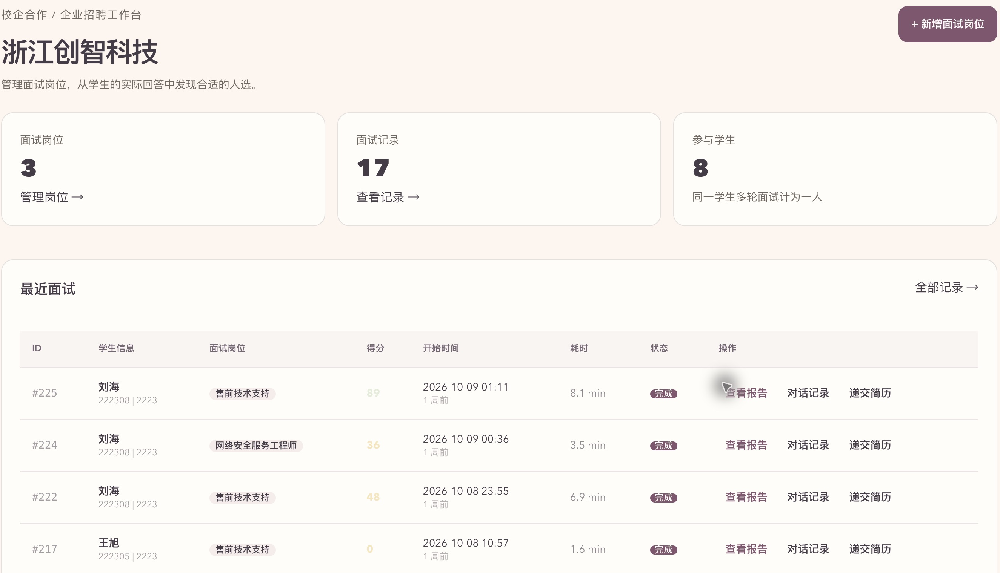

1. 核对公司名称，查看岗位数、面试记录数和参与学生数。
2. 点击“管理岗位”维护岗位，或点击“查看记录”进入本公司面试列表。
3. 在最近面试中点击报告、对话记录或递交简历，分别查看相关证据。

示例账号 zjczkj 属于浙江创智科技，联系人宋经理。采集时为 3 个岗位、17 条面试记录、8 名参与学生。

## E02 浏览岗位与进入关联面试

身份：企业。入口：顶部导航 → 面试岗位。核验：页面已核验。

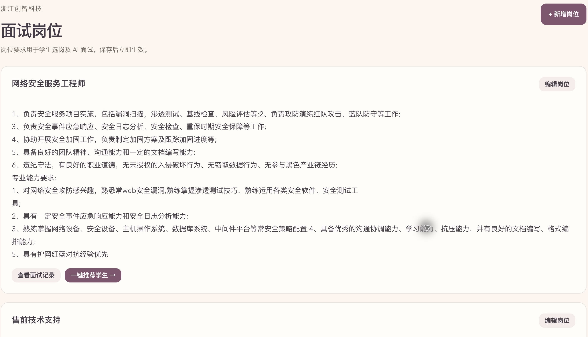

1. 查看本公司的岗位名称、职责和要求。
2. 点击“编辑岗位”维护内容；点击“查看面试记录”查看该岗位的面试。
3. 点击“一键推荐学生”查看系统生成的岗位推荐名单，或点击“新增岗位”打开新建表单。

页面提示岗位要求用于学生选岗和 AI 面试，保存后立即生效。本次没有改动岗位内容。

## E03 新增本公司面试岗位

身份：企业。入口：面试岗位 → 新增岗位。核验：新增表单已核验  未发布。

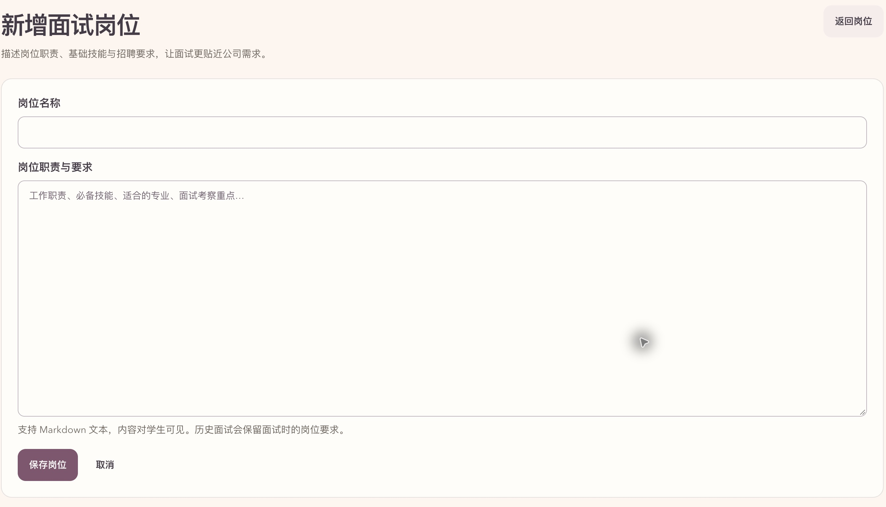

1. 填写岗位名称，明确招聘岗位。
2. 填写岗位职责与要求，可包括工作职责、必备技能、适合专业及面试考察重点。
3. 核对内容后点击“保存岗位”；不发布则点击“取消”或“返回岗位”。

输入支持 Markdown，内容对学生可见。页面提示历史面试保留当时岗位要求；本次只查看表单，未新增岗位。

## E04 编辑已有岗位

身份：企业。入口：面试岗位 → 对应岗位 → 编辑岗位。核验：编辑表单已核验  未保存。

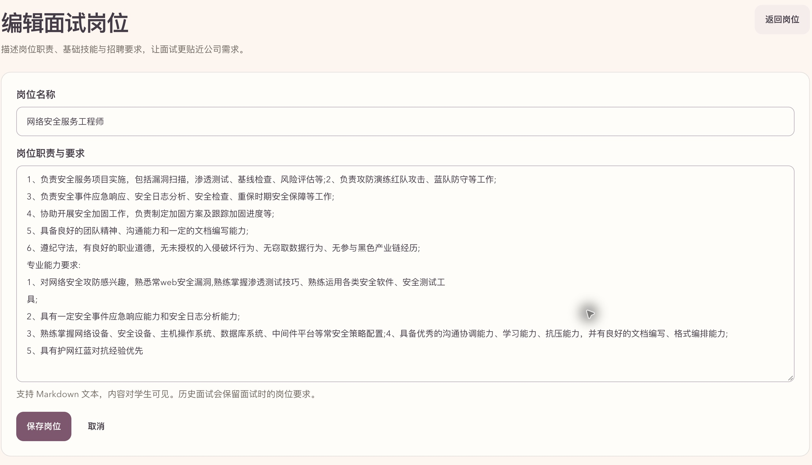

1. 核对原岗位名称和职责要求，确认正在维护的岗位。
2. 修改需要调整的内容，检查是否仍清楚描述职责、技能与考察重点。
3. 点击“保存岗位”生效，或取消返回；历史面试按页面说明保留当时的要求。

本次打开网络安全服务工程师编辑页，未改写或保存。企业端页面未见岗位删除入口。

## E05 查看岗位学生推荐及依据

身份：企业。入口：面试岗位 → 一键推荐学生。核验：页面已核验。

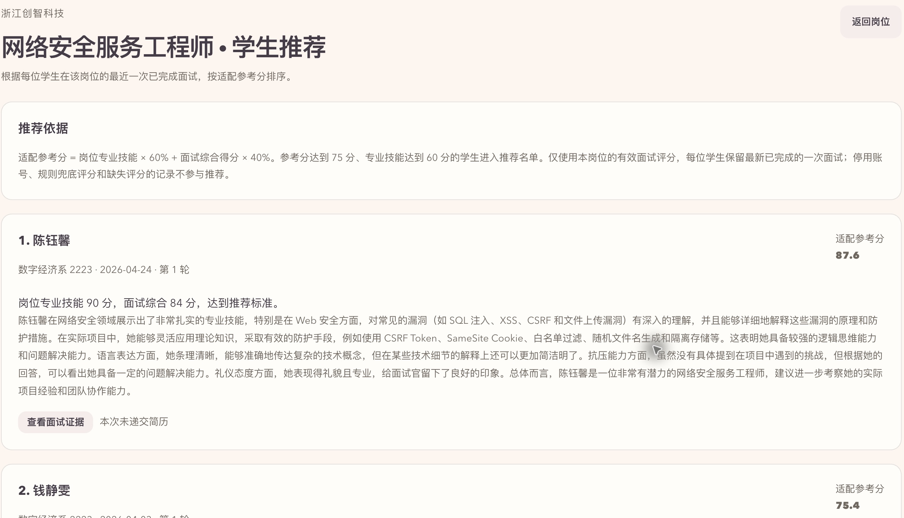

1. 先阅读推荐依据，确认当前岗位与入选条件。
2. 查看推荐学生的适配参考分、专业技能分、面试综合分及总结。
3. 点击“查看面试证据”核对原报告；有递交简历时结合简历查看，无简历时页面会提示。

页面规则：参考分为专业技能×60%＋综合分×40%，参考分≥75且技能≥60；每人取该岗位最新有效完成记录，排除停用、兜底及缺失评分。此为页面规则转述。

## E06 按岗位筛选学生面试记录

身份：企业。入口：顶部导航 → 学生面试记录。核验：页面已核验。

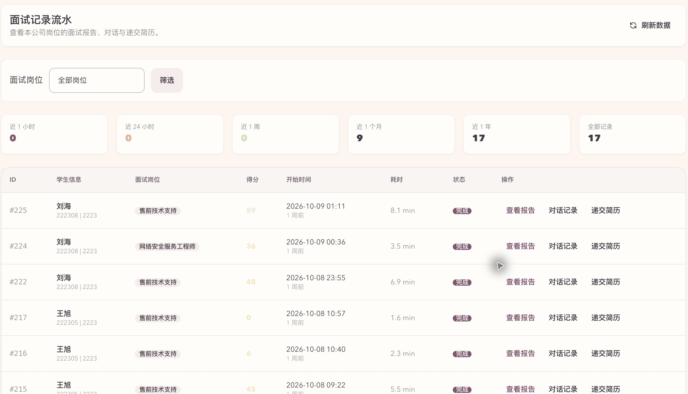

1. 在“面试岗位”下拉框选择岗位并点击“筛选”，或保留全部岗位。
2. 查看时间窗口统计，按学生、岗位、得分、时间、耗时和状态核对记录；需要时刷新数据。
3. 每条记录可进入“查看报告”“对话记录”；本次有递交简历时显示简历链接，否则显示未递交。

企业页面说明范围为本公司岗位。未见管理员的隐藏入口或学生名册管理入口；本次没有进行越权访问测试。

## E07 阅读面试报告与仪态证据

身份：企业。入口：学生面试记录 → 查看报告。核验：页面已核验。

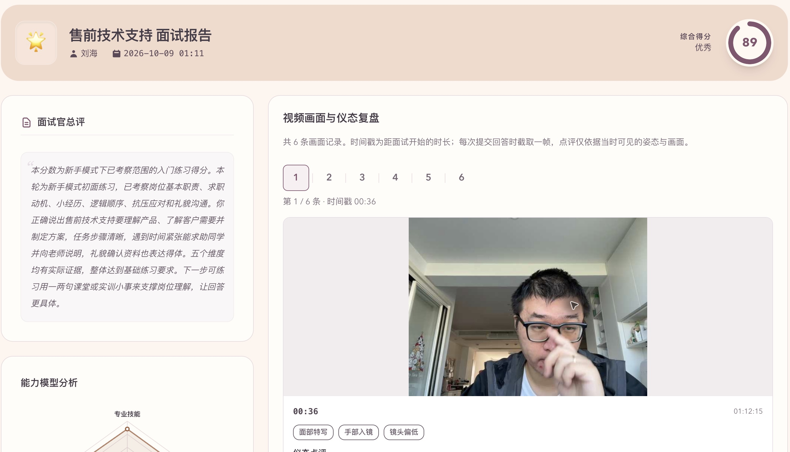

1. 核对岗位与学生，阅读综合得分、总评及五维能力分析。
2. 点击画面时间戳查看对应截图和仪态点评，通过“查看对应回答”定位原答复。
3. 下滚查看逐句复盘，或使用顶部链接进入对话记录、递交简历和岗位面试列表。

示例为售前技术支持历史报告。企业页面展示历史证据，本次未发起面试、修改评分或作出录用操作。

## E08 查看学生原始对话与画面

身份：企业。入口：学生面试记录 → 对话记录。核验：页面已核验。

1. 核对岗位、面试模式和已结束状态。
2. 在对话区域滚动阅读提问与学生回答，有画面时查看时间戳、关键词和仪态点评。
3. 需要完整画面时点击相应链接；点击“查看报告”回到综合复盘页。

这是历史面试回顾页面，不能在此替学生追加回答。本次只阅读记录。

## E09 查看面试时递交的简历

身份：企业。入口：面试记录 → 递交简历 或 报告 → 查看递交简历。核验：递交简历页已核验  未打印。

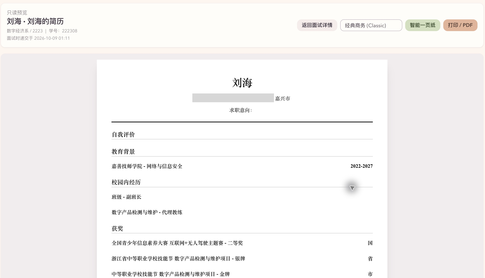

1. 核对学生姓名、学号、简历名称及“面试时递交于”的时间。
2. 在只读页面浏览内容，按需选择显示模板或使用“智能一页纸”。
3. 点击“打印 / PDF”进入打印流程，完成后可返回面试详情继续查看报告。

此入口与一条具体面试关联；未递交简历的记录不会提供同样内容。本次未打印，截图中的真实联系方式已遮盖。

## G02 选择页面主题

身份：通用。入口：页面右上角 → 主题。核验：主题选项已核验  未变更。

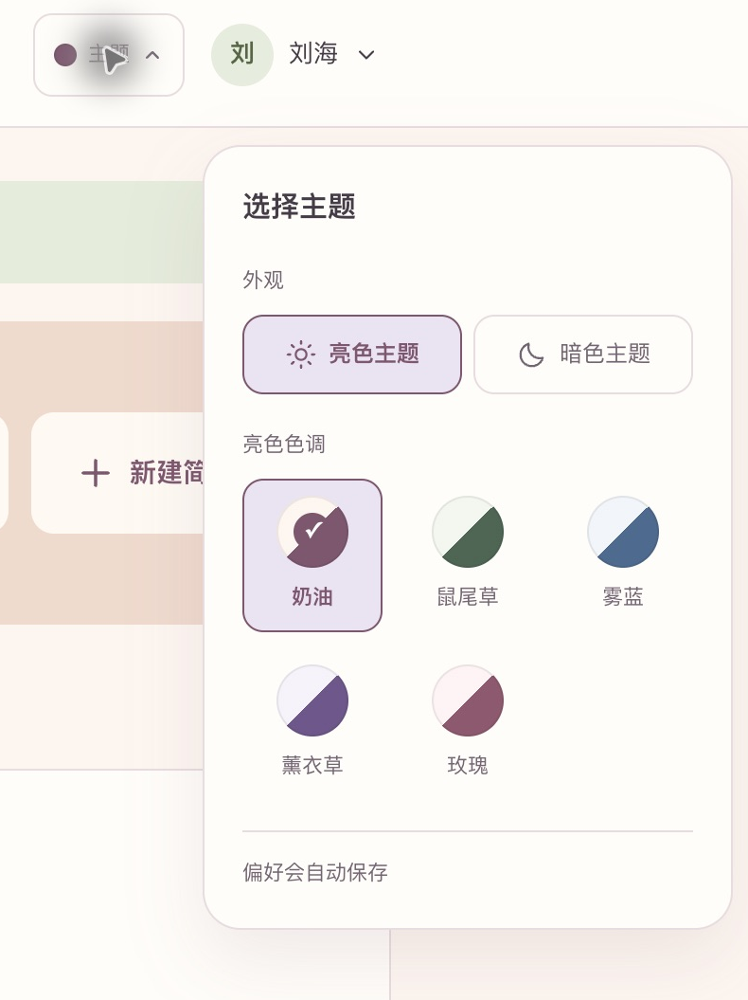

1. 点击“主题”打开选择面板，查看亮色和暗色外观。
2. 亮色主题可选择奶油、鼠尾草、雾蓝、薰衣草或玫瑰色调。
3. 选择需要的外观后关闭面板；页面说明偏好会自动保存。

本次仅展开主题面板，没有切换主题。截图以学生端为例，管理员和企业顶部同样提供主题入口。

## G03 自行修改登录密码

身份：通用。入口：右上角姓名 → 修改密码。核验：入口及空表单已核验  未改密。

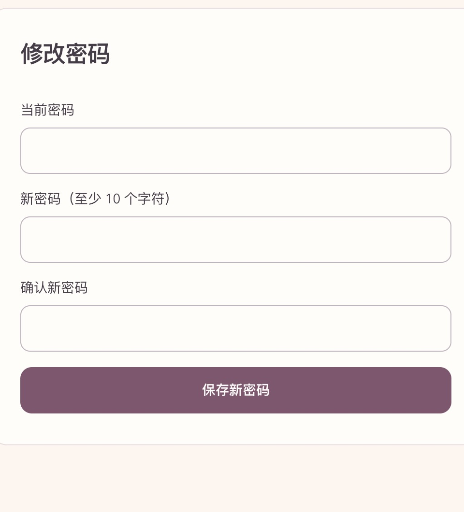

1. 在个人菜单进入“修改密码”。
2. 由账号持有人填写当前密码、新密码及确认新密码，页面要求新密码至少 10 个字符。
3. 持有人核对后自行点击“保存新密码”，按页面反馈完成后续登录。

本次仅查看空表单，没有输入新密码或提交。三种身份均可通过个人菜单找到密码维护入口。

## G04 查看 WikiBook 账号关联状态

身份：学生及管理员。入口：右上角姓名 → 账号关联设置。核验：当前未配置  暂不可完成关联。

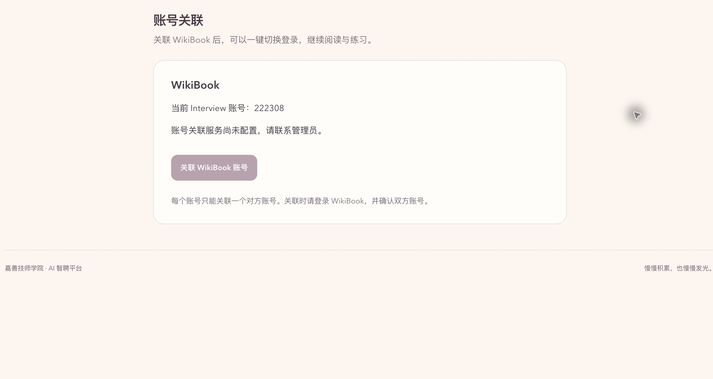

1. 打开关联页面，核对当前 Interview 账号。
2. 若服务已配置，可按页面要求登录 WikiBook 并确认双方身份。
3. 若显示“账号关联服务尚未配置，请联系管理员”，停止关联并交由平台管理员处理。

本次实际显示未配置，关联按钮禁用，因此不能完成绑定。企业账号个人菜单中未见该入口。

## G05 退出并切换账号

身份：通用。入口：右上角姓名 → 退出登录。核验：登录切换与退出已实际核验。

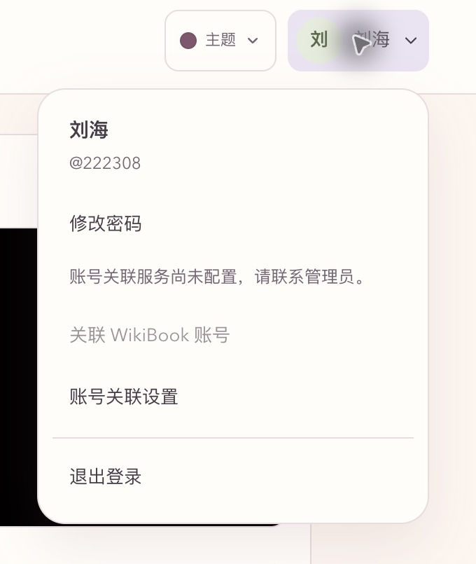

1. 点击右上角姓名，核对菜单显示的账号标识。
2. 点击“退出登录”，确认页面回到登录入口。
3. 需要其他身份时输入对应账号重新登录，再核对目标工作台。

本次三个账号均通过各自身份实际登录取证，切换前均退出；采集结束已退出最后使用的账号。
