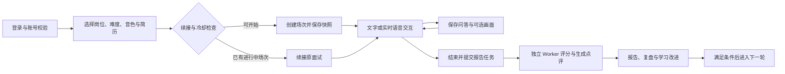
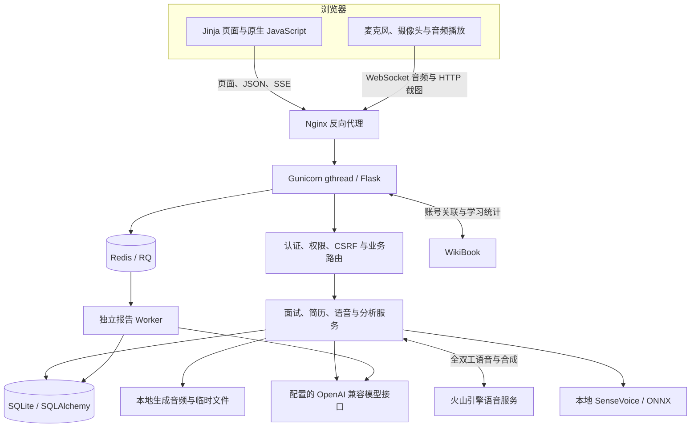
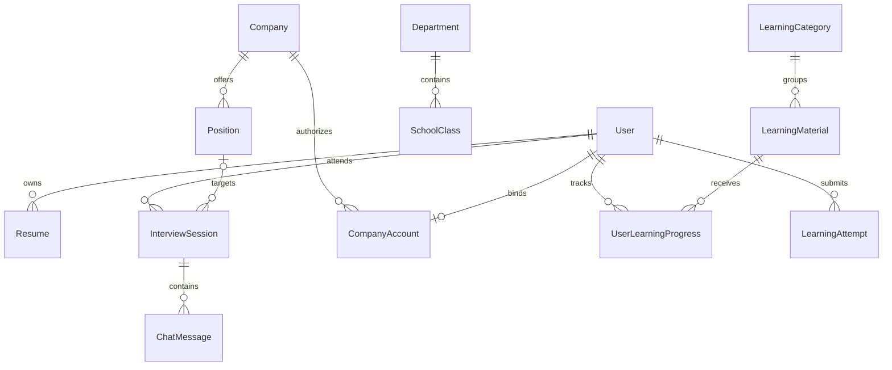

# AI 模拟面试平台项目分析报告

编写日期：2026 年 10 月 21 日  
分析对象：`/Users/laozhenyu/Project/interview` 当前工作区  
代码基线：Git HEAD `706b9bb`，并包含分析时已有的未提交代码与文档

## 一、项目概况与核心判断

本项目是一套面向职业教育与求职训练的 AI 模拟面试平台。它以学生的“准备简历 → 选择岗位 → 模拟面试 → 评分复盘 → 学习改进”为主线，同时提供教师教学管理、管理员运营配置和企业招聘协作入口。

从当前实现看，项目已超出单纯的聊天演示：具备统一账号、组织权限、简历快照、多轮面试、文字流式对话、实时语音、视觉仪态复盘、持久报告队列、学习测验、班级分析和企业推荐等业务模块。其技术形态是**服务端渲染的 Flask 模块化单体，加独立报告 Worker**。

主要结论如下：

1. **业务链路较完整。** 学生、教师、管理员、企业共享同一套数据和账号体系，训练结果能够进入教学管理与企业工作台。
2. **AI 与规则共同驱动。** 常规文字面试由程序安排五维覆盖问题，模型承担澄清、补充对话与评价；学生模式的分数由模型逐题提供证据，再由程序汇总。
3. **已有基础生产工程能力。** 包括数据库迁移、健康检查、RQ 队列、失败重试、状态校准、独立进程部署与浏览器回归测试。
4. **适合继续在现有单体上完善。** 当前主要约束是评估数据完整性、长连接容量、SQLite 写入竞争和发布一致性，尚无必要仅为形式拆分微服务。
5. **训练成绩与岗位胜任力仍需区分。** 当前得分主要表示指定难度与实际提问范围内的面试表现，不能直接等同于实际工作能力或录用结论。

### 1.1 分析方法与边界

本报告依据源码、依赖清单、部署配置、数据库模型、测试与仓库内历史记录编写。已实际运行本地非浏览器回归测试；没有连接生产服务器、执行线上压测或调用真实模型服务，也没有读取 `.env` 中的实际凭证。

下文中的“已实现”指当前代码存在相应路径；“历史验证”指仓库保存的特定日期结果；“建议”指后续工作。当前工作区包含未提交变更，因此报告并非只描述 HEAD 提交，也不能据此认定线上正在运行相同代码。

### 1.2 项目规模

以下数量来自当前工作区文件和模型定义的静态统计，不含虚拟环境及前端依赖目录：

| 指标 | 数量 | 说明 |
| --- | ---: | --- |
| 应用 Python 文件 | 43 | `app/` 下递归统计 |
| 页面模板 | 50 | `app/templates/` 下 HTML 文件 |
| 数据模型 | 18 | `app/models.py` 中的模型类 |
| 数据库迁移文件 | 8 | `migrations/versions/` |
| 单元及服务回归测试文件 | 19 | `tests/` 根目录 `test_*.py` |
| 浏览器端到端测试文件 | 18 | `tests/e2e/test_*.py` |

## 二、用户角色与功能架构

### 2.1 角色与数据范围

| 角色 | 核心职责 | 数据访问范围 |
| --- | --- | --- |
| 学生 `student` | 维护资料与简历、面试训练、查看报告、学习测验 | 个人训练与学习数据 |
| 教师 `teacher` | 查看学生表现、跟踪薄弱项、开展班级教学分析 | 主要按本人系部和班级过滤 |
| 系主任 `dept_head` | 系部学生管理与统计分析 | 本系部 |
| 管理员 `admin` | 组织与账号管理、内容配置、企业岗位与合作管理 | 全校及全局配置 |
| 企业 `company` | 管理本公司岗位、查看相关学生面试与递交简历、推荐候选人 | 通过 `CompanyAccount` 绑定的本公司 |

平台使用 Flask-Login 的会话认证。自行注册入口已关闭，学生账号通过后台导入等方式开通；企业账号由管理员创建，首次登录及密码重置后要求修改密码。

企业工作台额外通过应用级请求钩子限制可访问入口，并在查询中加入公司归属条件。教师和系主任的范围控制主要通过路由内查询及权限判断实现，而非独立的通用权限策略引擎。

### 2.2 学生功能

| 模块 | 当前能力 | 实现要点与边界 |
| --- | --- | --- |
| 基础资料 | 维护个人信息、求职目标等 | 结构化资料存入 `User.profile_info`，可导入简历 |
| 简历管理 | 创建、编辑、重命名、删除、模板预览、打印/PDF、AI 文案优化 | 每人最多 5 份；浏览器打印承担 PDF 输出 |
| 简历文件解析 | 上传 PDF、DOCX 并提取文本用于面试 | 使用 pdfplumber/python-docx；未实现 OCR 链路，扫描 PDF 不应视为已支持 |
| 正式面试 | 选择岗位、难度、音色和简历，进入问答 | 新手、标准、压力三种模式；岗位与简历在开始时保存快照 |
| 文字交互 | 流式显示回复、语音播报、回答时附带画面 | 通过 HTTP SSE 返回事件；音频 URL 随后返回 |
| 实时语音 | 麦克风持续输入、流式文字及语音输出、静音、打断、手动结束回答 | 由服务端代理外部全双工语音连接 |
| 仪态复盘 | 回看回答对应的截图、画面标签和建议 | 分析离散截图，不是连续视频理解或录像回放系统 |
| 报告复盘 | 总分、五维雷达、整体建议、逐题点评、参考回答 | 报告异步生成，可查询状态并在失败后重新提交 |
| 多轮进阶 | 初面、复面、终面 | 后续轮次继承岗位、递交简历快照和上一轮摘要 |
| 单题练习 | 随机抽题、提交回答、获得评分及建议 | `RandomPracticeAttempt` 持久保存练习结果 |
| 成长与能力 | 历史记录、成长曲线、能力雷达、薄弱问题、岗位匹配、排行榜 | 趋势是近期均值计算，岗位匹配依赖相同岗位历史 |
| 学习中心 | 阅读文章、完成测验、记录进度 | 测验由服务器判分，80 分及以上通过；保存失败尝试 |
| 跨站关联 | 关联 WikiBook 账号并切换登录 | 需显式配置两站地址与共享密钥 |

简历模块支持隐藏模块、字段、条目及技能。新面试保存的递交快照仅包含可见内容，同时保存模板与排版密度；企业查看历史简历时不会自动读取学生后来修改的在线简历。文件上传及部分旧记录只有文本快照，不能还原原始文档排版。

### 2.3 教师与管理功能

- **组织与账号管理：** 系部、班级维护，Excel 学生导入及模板下载，账号停用、恢复和密码重置。
- **教学分析：** 教师学生名单、学生详情、教学看板、班级/系部对比、班级能力画像与面试记录查看。
- **教学内容：** 学习分类、文章、测验及随机面试题库维护。
- **面试记录管理：** 按条件查询记录，查看报告、对话与画面；通过软删除隐藏符合条件的记录，并支持恢复。
- **运行策略：** 配置实时语音、文字 TTS、视觉分析开关，以及面试超时、冷却、复盘门槛、音频和临时文件保留时间。
- **校企合作：** 公司资料、岗位与联系人账号管理，同一公司可以关联多个联系人账号。

这些能力构成教学管理基础，但尚不能等同于完整教学任务系统。当前核心模型中没有独立的“教师发布任务—学生提交—教师批注—退回重做”任务与提交实体。

### 2.4 企业功能与推荐逻辑

企业可管理本公司岗位，按岗位查看进入报告阶段或已完成的学生面试，访问相关对话、报告、画面与递交简历。

“一键推荐学生”采用透明的规则排序：

```text
推荐参考分 = 专业技能分 × 60% + 面试综合分 × 40%
入选条件：专业技能分 ≥ 60，推荐参考分 ≥ 75
```

每位学生只比较该岗位最近一次已完成面试。停用学生、无效分数、规则来源评分及被隐藏的记录等不进入相应推荐链路；实现兼容 `evaluation_source` 为空的历史记录，未来可以进一步收紧来源标记。

该功能与学生端“岗位匹配”不同：企业推荐是固定规则计算；学生岗位匹配使用同岗位最近最多 10 次面试的维度均分和递交简历摘要，再请求模型生成匹配分、优势、差距及建议。两类结果不应在产品上使用同一解释口径。

## 三、关键业务流程

### 3.1 面试主流程



面试记录主要状态如下：

| 状态 | 含义 | 主要后续路径 |
| --- | --- | --- |
| `ongoing` | 正在面试 | 继续问答、结束生成报告，或放弃/超时 |
| `processing` | 报告处理中 | 成功进入 `completed`，耗尽重试或异常进入 `failed` |
| `completed` | 已形成报告 | 查看复盘、符合条件时进入下一轮 |
| `failed` | 报告未成功 | 可重新提交报告生成 |
| `expired` | 放弃或过期 | 保留历史；接口允许依据现有问答提交报告 |
| `deleted` | 软删除隐藏 | 保留原状态及操作信息，管理员可恢复 |

`report_queue_status` 进一步记录入队、排队、执行、重试等状态。业务状态与队列状态分开有利于定位问题，但两者需要持续校准。

### 3.2 训练节奏与多轮机制

普通学生的默认策略为：无活动 10 分钟后面试过期，放弃后冷却 10 分钟，完成后冷却 30 分钟，并要求查看上次报告。这些参数可由管理员调整。

测试账号另设体验策略：完成或放弃后等待 5 分钟，不要求先查看报告。账号使用数据库租约约束同一时间的浏览器登录，页面定期续期，关闭页面或断网后租约到期释放。

每轮最多关联一个下一轮，数据库通过 `parent_session_id` 唯一约束防止并发重复创建。当前学生模式下，三轮侧重点分别为基础求职、基础实操、协作与成长，不能把历史注释中的“高管面”直接当作当前学生轮次的要求。

“已复盘”目前是在学生打开已完成报告时设置，属于查看记录，尚未验证学生是否理解建议、重新作答或完成改进。

## 四、技术架构与实现

### 4.1 总体架构



Redis 在本项目中主要承载报告任务队列；不应据此推断已经实现通用业务缓存。实时语音也不是浏览器直接访问模型服务，而是经过 Flask 服务端转发，密钥由服务端持有。

### 4.2 技术栈

下表版本来自依赖清单，模型名称来自项目配置；并非对外部服务当前产品规格的独立核验。

| 层次 | 选型 | 作用 |
| --- | --- | --- |
| Web 框架 | Flask 3.1.2、Werkzeug 3.1.4 | 请求处理、路由、模板与 WSGI |
| 认证 | Flask-Login 0.6.3 | Cookie 会话登录与身份加载 |
| 数据访问 | Flask-SQLAlchemy 3.1.1、SQLAlchemy 2.0.49 | ORM、关联和事务 |
| 迁移 | Flask-Migrate 4.1.0、Alembic 1.18.4 | 版本化迁移与旧库接管 |
| 默认数据库 | SQLite | 同一应用数据文件；支持通过 `DATABASE_URL` 改写连接配置 |
| 生产服务 | Gunicorn 23.0.0、Nginx、systemd | 多进程线程服务、代理与进程守护 |
| 异步任务 | Redis、RQ 2.10.0 | 报告持久排队、重试、状态查询 |
| 文本及视觉接入 | OpenAI Python SDK 2.44.0，部分功能直接使用 requests | 调用兼容接口；默认文本模型标识 `deepseek-flash` |
| 实时通信 | flask-sock 0.7.0、websocket-client 1.9.0 | 浏览器 WebSocket 与语音上游连接 |
| 本地识别 | sherpa-onnx 1.13.8、SenseVoice、ffmpeg | 录音解码与离线转写 |
| 前端 | Jinja2、原生 JavaScript、Tailwind CSS 3.4.17、DaisyUI 4.12.10 | 服务端页面、交互与样式构建 |
| 图表与 Markdown | Chart.js 4.4.8、marked 12.0.2 | 雷达/趋势图表及前端 Markdown 展示 |
| 文件与表格 | pdfplumber、python-docx、pandas、openpyxl | 简历解析与 Excel 导入 |
| 测试 | pytest 8.3.5、Playwright 1.61.0、flake8 | 服务回归、浏览器测试、基础静态检查 |

Node.js 用于构建 CSS 和复制前端资源，生产请求不依赖独立 Node 服务。当前正式功能也不是 Vue/React SPA。

### 4.3 代码组织

| 位置 | 职责 | 架构观察 |
| --- | --- | --- |
| `app/__init__.py` | 应用工厂、扩展初始化、蓝图注册、健康检查、启动维护 | 应用装配入口明确 |
| `app/routes.py` | 页面与部分管理、学习、分析接口 | 约 1,872 行，混合展示、授权、查询和业务规则 |
| `app/api/interview.py` | 创建、聊天、结束、报告任务、下一轮、随机题、转写 | 约 980 行；HTTP 层与后台任务入口耦合 |
| `app/api/realtime.py` | 实时语音鉴权、事件转发与画面上传 | 网络状态与业务持久化协同较复杂 |
| `app/company_portal.py` | 企业隔离、岗位、面试与合作账号管理 | 企业业务入口相对集中 |
| `app/services/` | 模型、提示词、五维覆盖、报告队列、语音、推荐、快照等 | 已形成可复用服务层 |
| `app/models.py` | 统一数据模型 | 简单直接，后续可按业务域组织 |
| `app/integrations/` | WikiBook 关联与授权票据 | 外部系统边界相对清楚 |
| `app/static/`、`app/templates/` | 页面、脚本、样式、本地第三方资源 | 多页面应用，部分复杂交互仍在模板中 |
| `scripts/`、`deploy/`、`migrations/` | 构建、评估、部署与数据演进 | 运维和验证工具已有积累 |

### 4.4 文字对话与 TTS

文字聊天先鉴权并保存用户消息，随后读取历史、岗位快照、简历及上一轮摘要，调用流式面试接口。HTTP 以 `text/event-stream` 返回 `token`、`visual`、`audio`、`error`、`done` 等事件。

当前代码中的语音播报是**完整文本生成后再分句合成**，并非每得到一个文本 token 就同时合成对应音频。因此流式文字可以较早出现，但语音起播仍包含完整文本生成和首句合成等待。

如果同时提交画面，文字聊天路径会先同步执行视觉分析，再进入后续回复生成；这会增加该请求的首字等待。实时语音路径的画面采用独立 HTTP 请求，不阻塞音频转发。两条路径的延迟特性需要分别描述和测量。

生成失败的 AI 消息带有 `generation_status`、错误和模型信息，后续面试上下文和报告排除未完成消息，避免把失败片段当成正式问答。

### 4.5 实时语音与录音转写

项目存在两条不同链路：

| 链路 | 数据路径 | 特点 |
| --- | --- | --- |
| 实时全双工语音 | 浏览器 PCM → Flask WebSocket → 火山实时服务 → 流式文字/音频 | 当前配置模型版本为 `1.2.6.1`，输入 16 kHz、输出 24 kHz，单声道 PCM16 |
| 录音后转写 | 浏览器录音文件 → ffmpeg 解码 → 本地 SenseVoice → 文字 | 本地推理，无需云端 ASR 密钥；后续文字问答仍可能调用外部模型 |

实时音频按 20 ms 分包。服务端使用连续静音窗口暂存提前生成的回复，候选人继续说话时取消暂存，连续安静约 3 秒后释放。用户也可点击“我说完了”主动结束本次输入，绕过静音等待。

当实时服务没有生成可用回复时，手动接话恢复机制可根据已保存转写与上下文请求文字模型，再通过选定音色播报。实际问答、输出音频和画面由独立逻辑记录。

本地 SenseVoice 每个 Web 进程按需加载一次模型，进程内通过锁串行识别。因此增加 Web 线程数不等于同比增加本地语音识别吞吐量。

### 4.6 AI 提问、评分与视觉分析

**提问规则。** `interview_coverage.py` 识别五维题目与有效回答，区分澄清、重复题提醒和结束请求。常规文字路径优先选择尚未覆盖的固定问题，模型参与解释、补充与扩展练习；实时路径将覆盖要求放入语音模型指令，不能视为同一个确定性状态机。

**评分规则。** 当前学生模式先取得逐题维度分与理由，再校验题序、范围和有效作答，过滤与本题无关的维度，汇总五维分数。总分由程序按以下权重计算：

| 维度 | 基础权重 |
| --- | ---: |
| 专业技能 | 40% |
| 逻辑思维 | 25% |
| 语言表达 | 20% |
| 抗压能力 | 10% |
| 礼仪态度 | 5% |

当部分维度未考察时，只使用已评估维度的权重重新归一化计算总分；未评估项的 0 分用于兼容现有界面，不代表能力为零。学生模式不因作答数量不足而直接封顶；兼容的非学生模式路径仍保留少于三组回答时总分最多 60 的逻辑，不能把旧规则泛化为当前三个学生模式。

逐题点评接收同一份评分证据，学生模式下回答是否合格按对应题目评分判断，基础分达到 80 视为合格，避免点评模型另用更严格要求推翻结果。报告结构或字段校验失败会抛出错误，进入任务失败/重试路径，而非生成一份貌似成功的默认评分。无候选人回答时另返回“无证据”的规则结果及占位零分。

**版本追踪。** 当前提示词常量为：

- 对话：`interview-chat-v9-coverage-recognition`。
- 报告：`interview-report-v10-question-evidence`。

面试与报告保存模型标识、提示词版本和错误信息，便于追溯。模型 SDK 的兼容接入便于更换服务商，但不同接口能力仍需实际验收。

**视觉边界。** 图像用于仪态提示，不进入面试提问与评分消息。上传帧限制为不超过 512 KB 的 JPEG/PNG，保存截图、采集时间及点评。`VLM_MODEL_NAME` 默认继承文本模型名，实际配置的服务是否支持图像输入需要单独验证；仅存在调用代码不能证明视觉服务已可用。

### 4.7 报告异步架构

结束接口先把场次标记为 `processing`，提交报告任务后立即返回。独立 Worker 读取已完成问答，生成整体分数及逐题点评，再更新数据库。页面通过状态接口轮询。

队列提供三种模式：

| 模式 | 行为 | 使用场景 |
| --- | --- | --- |
| `rq` | 使用 Redis/RQ；Redis 故障时入队失败；Worker 暂时离线时任务可留队 | 生产默认并由生产脚本强制设置 |
| `auto` | 有可用 RQ Worker 时使用队列，否则显式回退线程 | 开发环境默认 |
| `thread` | 进程内守护线程，无持久保障 | 本地调试 |

任务 ID 包含面试 ID 和提交次数，配合唯一入队限制重复任务。任务执行、提交次数和关键时间持久化；默认任务超时为 600 秒，失败重试间隔为 30、120 秒。状态同步与 `reconcile-report-jobs` 命令用于处理异常任务。

这些机制降低了长请求和进程重启导致报告丢失的风险，但数据库提交与 Redis 入队仍是两个步骤，不具有跨存储事务；状态轮询与 Worker 回写也需要继续用并发测试防止旧状态覆盖新状态。Redis 的落盘、备份及恢复策略决定队列在主机级故障下的实际保障范围。

## 五、数据架构

### 5.1 核心实体

| 业务域 | 模型 | 关键数据 |
| --- | --- | --- |
| 身份与组织 | `User`、`Department`、`SchoolClass`、`TestAccount` | 角色、账号状态、系部班级、基础资料、体验账号租约 |
| 简历 | `Resume` | 标题、模板、结构化内容、布局与隐藏配置 |
| 面试 | `InterviewSession`、`ChatMessage` | 岗位与简历快照、问答、评分、轮次、任务状态、截图和点评 |
| 企业 | `Company`、`Position`、`CompanyAccount` | 公司资料、岗位描述、账号归属 |
| 学习 | `LearningCategory`、`LearningMaterial`、`UserLearningProgress`、`LearningAttempt` | 内容、完成状态、测验得分及历次提交 |
| 随机练习 | `RandomPracticeAttempt` | 单题问题、回答、分数、建议、来源模型和异常 |
| 系统与集成 | `SystemConfig`、`AccountLink`、`AccountLinkTicket` | 开关策略、跨站一对一关联、一次性授权票据 |

### 5.2 主要关系



关系图是核心逻辑关系摘要。需注意，用户所属系部和班级当前保存为字符串字段，并非 `User` 到 `Department`/`SchoolClass` 的外键；组织改名与人员迁移仍依赖业务代码维持一致。

### 5.3 数据设计优点

- **历史快照：** 岗位、递交简历及上一轮摘要被冻结，减少实时资料变化对历史结果的影响。
- **可追溯字段：** 模型、提示词版本、任务次数、时间及错误信息可以辅助诊断评分和任务问题。
- **历史保护：** 面试软删除保留记录；存在历史面试或账号归属的公司、岗位禁止直接删除。
- **关键唯一性：** 用户名、账号关联、学习进度与下一轮关联等设置唯一约束，减少重复数据。
- **显式迁移：** Alembic 管理数据结构，应用启动不隐式建表，支持迁移检查及旧 SQLite 数据接管。

### 5.4 主要数据约束

1. **评分证据尚未完整结构化落库。** 评分返回的 `evaluated_dimensions` 和 `question_scores` 没有独立持久字段；后台主要保存总分、五维数值、整体评语及逐题建议。未评估维度用 0 占位后，统计很难仅凭数值区分“没有问到”和“实际得零分”。
2. **跨场次比较条件不足。** 虽然保存了难度、岗位和提示词版本，部分成长、雷达和排名仍直接汇总成绩，未普遍按这些条件建立可比口径。
3. **组织成员关系依赖文本。** 系部与班级重名、改名时需要额外维护，长期适合改为稳定组织 ID。
4. **截图存入数据库。** `visual_image` 使用延迟加载的二进制列，有利于避免普通查询读取大字段，但仍会扩大 SQLite 文件和备份体积。
5. **时间策略尚未完全统一。** 业务中广泛使用无时区的 `datetime.now()`，跨站统计额外配置历史记录时区；多环境部署时应统一时间写入、转换与测试约定。

## 六、部署、运维与安全

### 6.1 当前生产部署方式

`run-production.sh` 强制生产环境、关闭调试和自动重载，并选择 Web 或 Worker 启动方式。默认 Web 配置为 4 个 `gthread` 工作进程、每进程 16 个请求线程。

```text
浏览器 → Nginx → Gunicorn/Flask（默认 4 × 16）
                           ├─ SQLite 与本地文件
                           ├─ 外部模型/语音服务
                           └─ Redis/RQ → 独立报告 Worker
```

Nginx 配置支持 WebSocket 升级，关闭代理响应缓冲以支持 SSE，读取超时为 300 秒。生产 SQLite 连接设置包含 20 秒锁等待和每进程连接池限制。仓库部署记录说明特定服务器启用了 WAL，但当前 Python 生产配置不自动执行 WAL 初始化，迁移到新主机时需要显式检查。

一个实时会话会长期占用请求处理线程，还可能伴随上游接收和恢复处理线程。64 个请求线程不是 64 人完整多模态并发容量的保证，实际容量取决于内存、长连接占用、截图请求、本地识别、数据库写入和外部服务限额。

仓库同时存在根目录和 `deploy/` 的若干部署文件；`vercel.json` 仍将请求重写到 `/index.html`。该配置不能承担当前 Flask、WebSocket、本地识别和独立 Worker 的完整部署，应明确有效配置入口，避免误用历史文件。

### 6.2 健康与发布检查

| 入口/命令 | 作用 |
| --- | --- |
| `/healthz` | 检查进程能够响应以及数据库 `SELECT 1` |
| `/readyz` | 检查数据库迁移版本与报告队列就绪状态 |
| `/queuez`、`queue-status` | 查看队列状态、Worker 和积压等信息 |
| `queue-probe` | 提交实际队列探针任务，验证执行链路 |
| `bootstrap-db`、`migration-status` | 初始化/升级数据库与查看版本 |
| `reconcile-report-jobs` | 校准异常遗留报告状态 |

这些入口不包含真实文本、视觉和语音模型的全面可用性验证。即使 `/readyz` 返回成功，也仍可能遇到模型权限、音色资源、网络或上游配额问题。

评分相关代码或环境变量更新后，需要同时刷新 Web 与报告 Worker。仓库 2026 年 10 月 9 日记录过“文件已更新但报告进程未重启，仍使用旧提示词”的事件，说明发布一致性检查有实际必要。

### 6.3 现有安全措施

- 服务端生成密码哈希，支持停用账号及强制改密。
- 对基于 Cookie 的状态变更执行 CSRF 校验，Cookie 配置 HttpOnly、SameSite，生产默认 Secure。
- 实时 WebSocket 验证登录、Origin、首条消息 CSRF、场次归属及启用状态。
- 配置内容类型、嵌入限制、Referrer 与摄像头/麦克风权限策略等响应头。
- 服务端 Markdown 使用标签、属性和 URI 白名单清洗。
- 简历文件限制扩展名并使用临时文件；图片进行格式、签名与大小检查。
- 模型密钥保留在服务端；跨站关联采用共享凭证和短期一次性票据，数据库保存票据摘要。

以上是实现层措施，不构成一次完整安全审计或渗透测试结论。

### 6.4 运维与隐私待完善点

1. **音频访问控制：** 生成音频位于静态上传目录，以文件 URL 提供访问；不像截图接口那样逐次校验场次权限。应评估迁移到鉴权下载或短期签名链接。
2. **数据保留：** 当前清理逻辑覆盖生成音频与临时文件，默认分别为 30 天和 24 小时；主要在应用创建时触发，尚不足以保证长期运行时严格按时清理。截图、文本和报告缺少同等明确的自动保留策略。
3. **运行权限：** 当前 `deploy/` systemd 示例使用 root 用户和 `/root` 工作目录，可逐步改为专用低权限账户。
4. **HTTPS：** 仓库历史部署入口为 HTTP。正式浏览器麦克风、摄像头与 Secure Cookie 都要求正确处理 HTTPS；历史公网可达不等于目前全部设备能力可用。
5. **可观测性：** 已有日志和基础健康指标，但尚未看到统一的模型调用成本、首字/首音延迟、请求追踪与告警系统。
6. **限流与资源配额：** 尚未看到统一登录尝试限制、AI 调用限流及按用户预算控制，应结合实际部署层配置补充核验。

## 七、测试与验证结果

### 7.1 本次实际执行

在测试环境、内存数据库及占位模型密钥下运行：

```bash
APP_ENV=testing \
SECRET_KEY=analysis-test-secret \
LLM_API_KEY=analysis-placeholder \
DATABASE_URL=sqlite:///:memory: \
REPORT_QUEUE_MODE=thread \
.venv/bin/python -m pytest -q tests --ignore=tests/e2e --disable-warnings
```

结果：**321 passed，74 warnings，耗时 47.97 秒。**

这验证了当前非浏览器测试集合，包括面试评分与覆盖、报告与会话回归、企业隔离、账号关联、迁移、语音协议及恢复等已有用例。它不代表全部行为已覆盖，也不验证生产 Redis、真实模型服务、真实设备或持续并发。本次未运行浏览器 E2E；警告未在本次报告任务中逐项治理。

### 7.2 测试工程与 CI

项目有基于 Playwright 的独立测试服务，使用临时数据库、固定测试数据和随机端口，失败保留截图与 trace。端到端用例覆盖核心流程、企业工作台、账号关联、主题、移动端布局及语音交互等。

GitHub Actions 配置包含 Python 3.12、依赖安装、静态检查、指定回归测试和浏览器 E2E。不过非浏览器 CI 当前仅显式执行 `test_regressions.py`、`test_company_portal.py`、`test_migration_guard.py`，没有覆盖本次运行的全部 19 个测试文件。建议将完整非 E2E 集合纳入默认检查，特别是提示词、评分、覆盖规划和实时接话恢复用例。

### 7.3 历史并发记录

仓库 2026 年 10 月 7 日的部署记录在 8 核、约 8 GB 内存服务器上，使用 32 个临时账号进行了一次真实接口批次验证：

| 项目 | 成功数 | P95 |
| --- | ---: | ---: |
| 登录 | 32/32 | 1.046 秒 |
| 登录后页面访问 | 320/320 | 0.226 秒 |
| 首次加载录音转写 | 32/32 | 7.230 秒 |
| 预热后录音转写 | 32/32 | 6.244 秒 |
| 真实模型 SSE 对话 | 32/32 | 2.351 秒 |

适用边界必须与数字同时保留：

- 转写使用约 5.59 秒中文样本，文字对话要求简短回复。
- 当时 32 次文字对话均未获得播报音频，记录显示语音资源授权失败。
- 当时服务器版本未包含本地新版实时语音接口，未验证 32 人全双工语音。
- 记录采用 2 个独立报告 Worker，排队 32 份报告不等于同时执行 32 份报告。
- HTTP 上传样本测试不代替浏览器授权、录音和摄像头流程。
- 记录同时指出磁盘接近满载；这是历史风险信号，本报告未核验当前磁盘状态。

这些结果能够支持当时配置下的基础接口可用性判断，不能外推为当前版本的持续满载能力承诺。

## 八、主要问题与改进优先级

下表优先级用于产品及工程排期：P0 表示应先于进一步扩大成绩使用范围处理，P1 表示下一阶段重点，P2 表示后续演进。它们不是已复现故障的统一严重等级。

| 优先级 | 问题 | 当前影响 | 建议 |
| --- | --- | --- | --- |
| P0 | 未评估状态与逐题证据没有完整结构化持久化 | 统计可能把占位 0 当低分；难以复核历史打分过程 | 保存已评估维度、逐题分数及理由，统计排除未评估项，UI 单独展示状态 |
| P0 | 不同岗位、难度、提示词版本和辅助条件的成绩可比性不足 | 汇总分、排名与企业判断可能被过度解释 | 明确训练口径，按条件分组，并显示范围与证据充分程度 |
| P1 | Web 与 Worker 发布版本可能不同步 | 新规则未在报告进程生效 | 统一发布清单，记录构建版本，增加实际队列版本探针 |
| P1 | 数据库、入队与状态回写跨进程协调 | 异常退出或并发查询可能造成状态不一致 | 补充故障注入和并发测试，使用条件更新；必要时引入事务发件箱 |
| P1 | 长连接与普通请求共享线程资源 | 实时会话增加时可能影响页面、提交及健康检查 | 测量完整语音链路容量，设置连接预算，按数据决定是否独立语音网关 |
| P1 | SQLite、本地截图及单机文件存储 | 写竞争、数据库体积和多实例一致性限制 | 先监测写锁和备份时长，达到阈值再迁移 PostgreSQL/对象存储 |
| P1 | 画面分析阻塞文字对话首字 | 带画面回答的等待可能显著增加 | 独立视觉任务，以消息 ID 关联结果，允许文字先返回 |
| P1 | 音频鉴权及截图/文本保留策略不足 | 隐私访问与生命周期治理不完整 | 统一受控访问，配置分类保留策略与定期清理 |
| P1 | CI 未运行完整服务测试集合 | 关键评分或语音逻辑变更可能缺少自动阻断 | 纳入全部非 E2E 测试，并保留核心浏览器验收 |
| P2 | 页面路由及面试模块职责较集中 | 修改影响范围扩大、规则不易复用 | 按面试、学习、组织、分析拆分蓝图和应用服务 |
| P2 | 打开报告即视为复盘，阅读完成记 100 分 | 学习参与与掌握程度容易混淆 | 区分已查看、已阅读、测验通过、完成改进；加入针对性重答 |
| P2 | 文档及部署入口存在历史残留 | 新成员运行、部署易产生误判 | 修复 README 中缺失的使用说明链接，整理部署文件和有效入口 |

### 8.1 建议实施顺序

**第一阶段：统一评价数据与发布验证。** 先补齐评估证据持久化和统计口径；将完整服务测试纳入 CI；统一 Web/Worker 发布检查。阶段验收应包含“未考察维度不拉低统计均值”“历史分数能够解释对应问答”“队列任务确实使用目标版本”。

**第二阶段：验证真实交互与运行边界。** 在隔离环境中完成持续实时语音、带截图文字对话、报告积压、Redis/Worker 中断和恢复测试，同时建立首字、首音、队列等待、写锁及磁盘增长指标。补齐 HTTPS、音频访问控制与定期清理。

**第三阶段：完善教学改进闭环。** 把“查看报告”升级为确认改进点、重答或新情境练习；将阅读、测验与实践成果分开。只有在任务负载和数据增长证明必要时，再实施数据库、存储及服务拆分。

## 九、项目定位与后续建设判断

当前项目适合作为**职业教育场景的 AI 面试训练与校企协作平台**继续建设。它的主要资产是已经贯通的业务流程、岗位与简历快照、学生适配的问答规则，以及围绕真实使用问题积累的测试与修复记录。

后续投入的重点应是让评价更可解释、统计更可比、交互更稳定、教师干预更有效。保留现有 Flask 架构并逐步划清业务边界，可以在控制改造成本的同时支撑这些目标。

## 附录：关键依据

以下链接均为仓库相对路径，可直接从本报告跳转到对应实现或历史记录：

| 分析主题 | 主要依据 |
| --- | --- |
| 项目运行与功能说明 | [README](../README.md)、[依赖清单](../requirements.txt)、[前端构建配置](../package.json) |
| 应用装配与健康检查 | [应用工厂](../app/__init__.py)、[配置](../app/config.py) |
| 数据模型与历史快照 | [数据模型](../app/models.py)、[递交简历快照](../app/services/submitted_resume.py) |
| 面试生命周期与报告写入 | [面试 API](../app/api/interview.py)、[会话状态](../app/utils/session_state.py) |
| 提问与评分 | [AI 服务](../app/services/ai_agent.py)、[提示词](../app/services/interview_prompts.py)、[五维覆盖](../app/services/interview_coverage.py) |
| 实时语音与恢复 | [语音接口](../app/api/realtime.py)、[上游协议与记录](../app/services/realtime_voice.py)、[静音窗口](../app/services/realtime_turns.py)、[手动接话恢复](../app/services/realtime_manual_reply.py) |
| 录音与画面 | [本地识别](../app/services/local_asr.py)、[视觉记录](../app/services/visual_review.py) |
| 队列 | [队列服务](../app/services/report_queue.py)、[Worker 入口](../worker.py) |
| 企业与推荐 | [企业工作台](../app/company_portal.py)、[推荐规则](../app/services/company_matching.py) |
| 成长、匹配与教学管理 | [洞察接口](../app/api/insights.py)、[页面与教学路由](../app/routes.py) |
| 安全与保留策略 | [安全钩子](../app/security.py)、[Markdown 清洗](../app/filters.py)、[文件清理](../app/services/storage_cleanup.py) |
| 跨站关联 | [账号关联说明](account-linking.md)、[集成模块](../app/integrations/account_link.py) |
| 部署与测试 | [Gunicorn](../gunicorn.conf.py)、[生产脚本](../run-production.sh)、[CI](../.github/workflows/tests.yml) |
| 历史性能结果 | [32 人部署记录](deployment-32-users.md)、[原始测试结果](deployment-32-users-results.json) |
| 评分发布历史 | [逐题评分修复记录](interview-question-scoring-fix-2026-10-09.md) |
